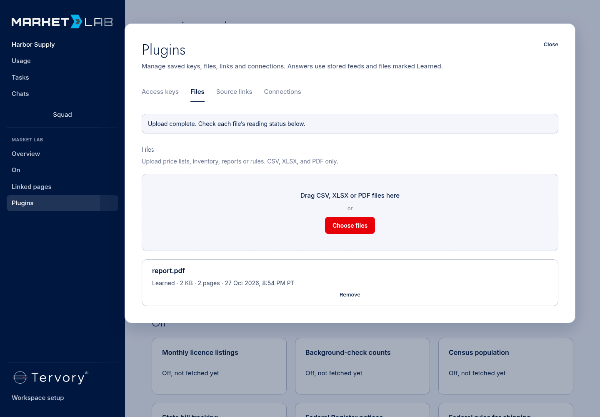
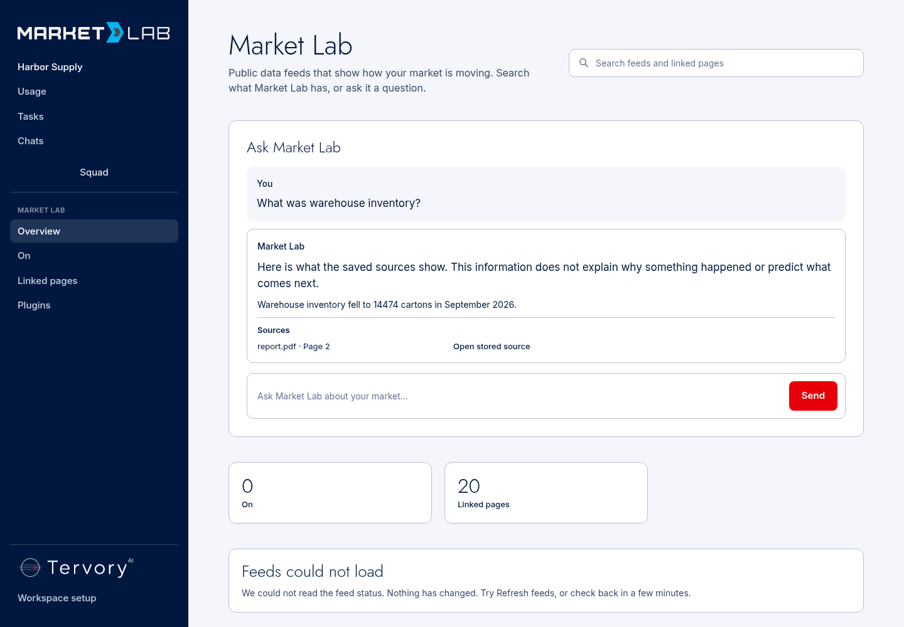
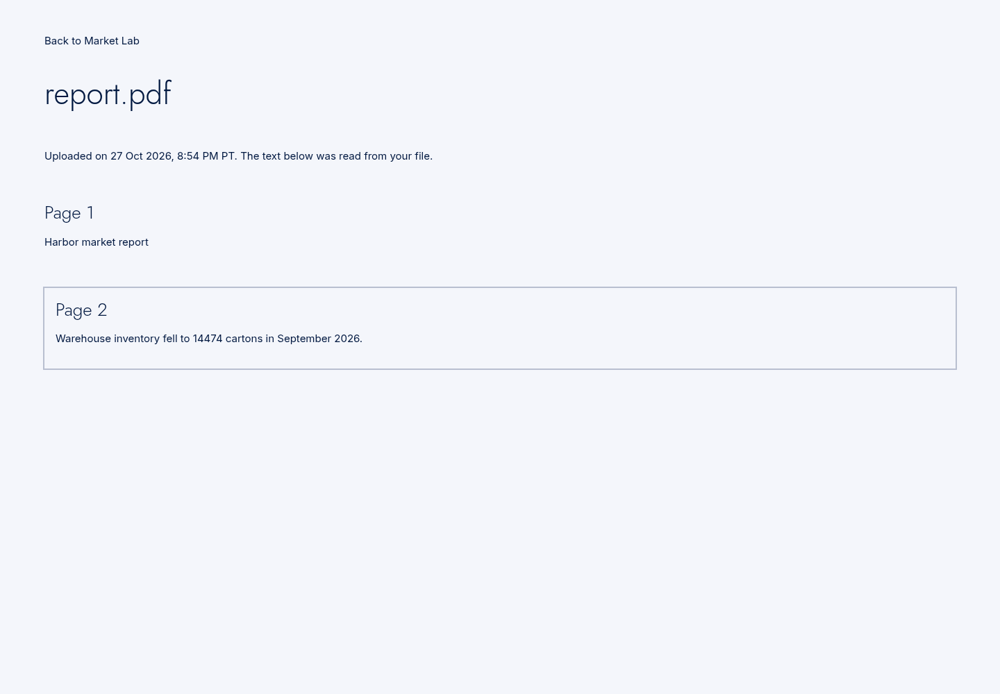
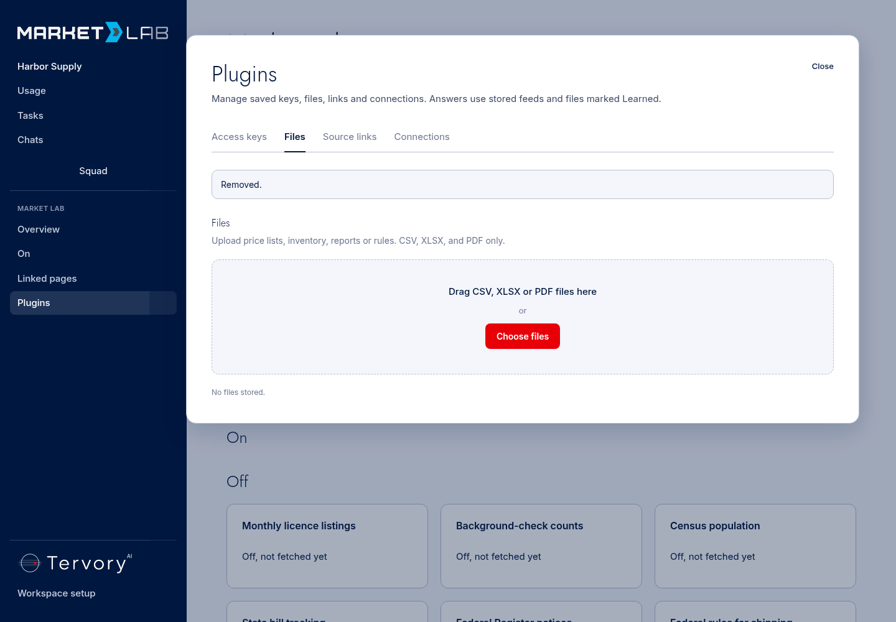
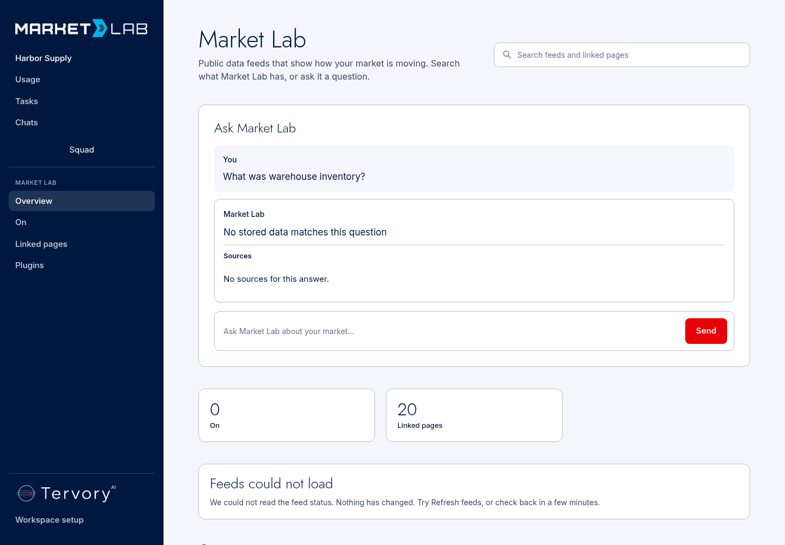
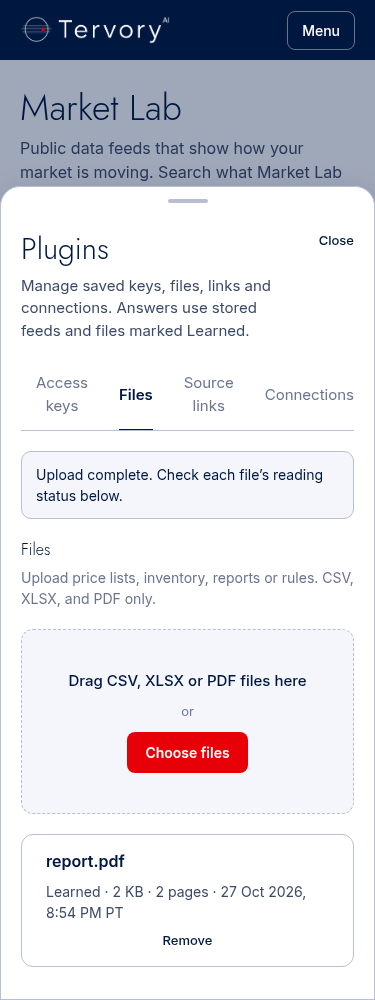
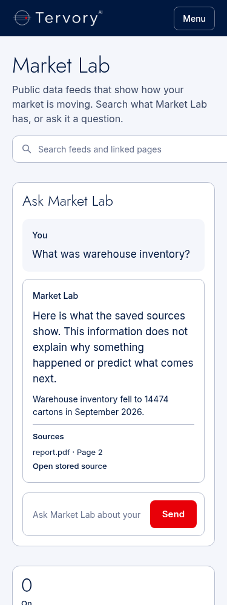
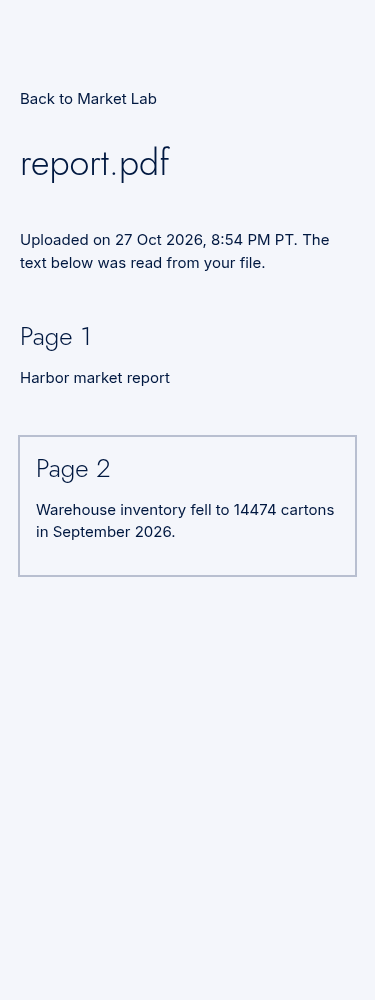
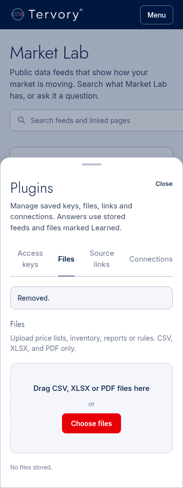
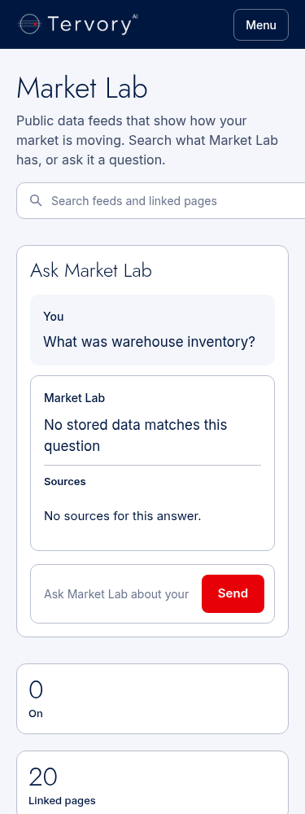

# Document proof

Every screenshot below is **local, fixture page**. The isolated Next wrapper
supplies a local identity; it is not a Clerk session or a live account. The
production components, upload route and removal action call the real Tank and
Market Lab room with real local Postgres. Only the external R2 transport is
stubbed. The report is generated by the reproducible test harness.

Run commands and remaining live acceptance are in [DOCUMENTS.md](../../DOCUMENTS.md).

Checks ran from a clean source clone of code commit `9efac63`, using the pinned
installed dependencies and a fresh local Postgres database. [Lint](lint.txt),
[offline tests](pytest.txt), [real-Tank pytest](real-tank-pytest.txt),
[Next build](next-build.txt), [Tank startup](tank-startup.txt) and [job output](job.json)
are saved here. The four offline skips are the optional database checks; the
new document path also ran separately against the real Tank and Postgres.
The browser capture uses the same code and is recorded in [browser.json](browser.json).

## Desktop

local, fixture page — Uploaded report marked Learned, 1440px.

local, fixture page — Question answered from the report, 1440px.

local, fixture page — Cited page highlighted, 1440px.

local, fixture page — File removed, 1440px.

local, fixture page — Same question after removal, 1440px.

## Phone

local, fixture page — Uploaded report marked Learned, 375px.

local, fixture page — Question answered from the report, 375px.

local, fixture page — Cited page highlighted, 375px.

local, fixture page — File removed, 375px.

local, fixture page — Same question after removal, 375px.
