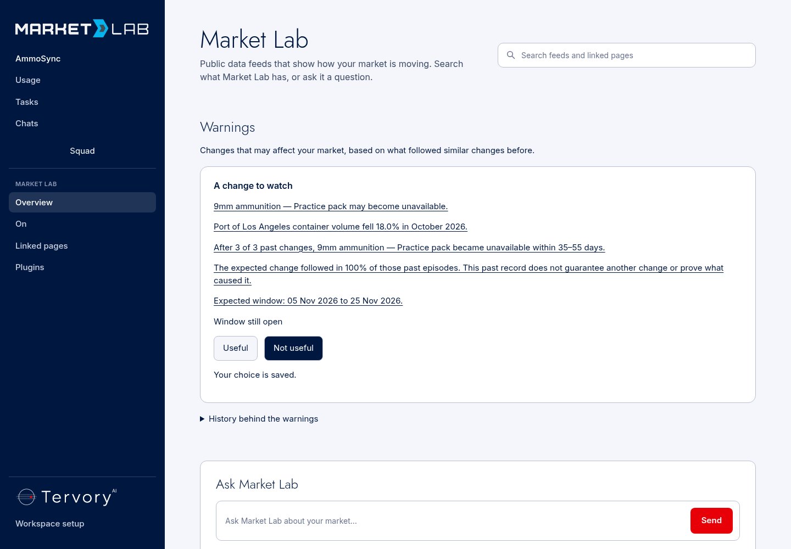
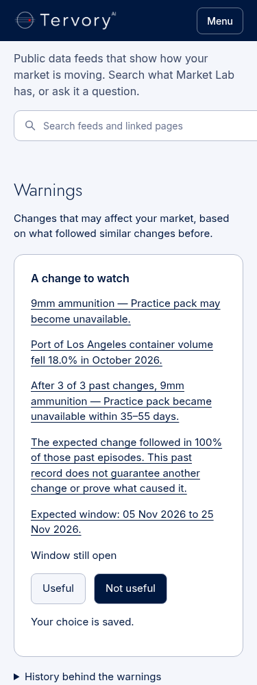
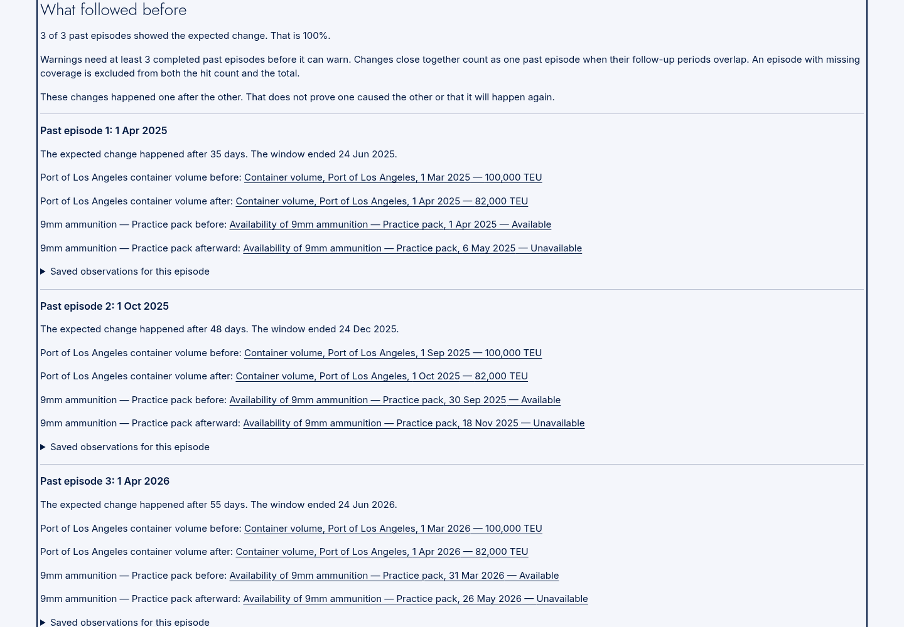
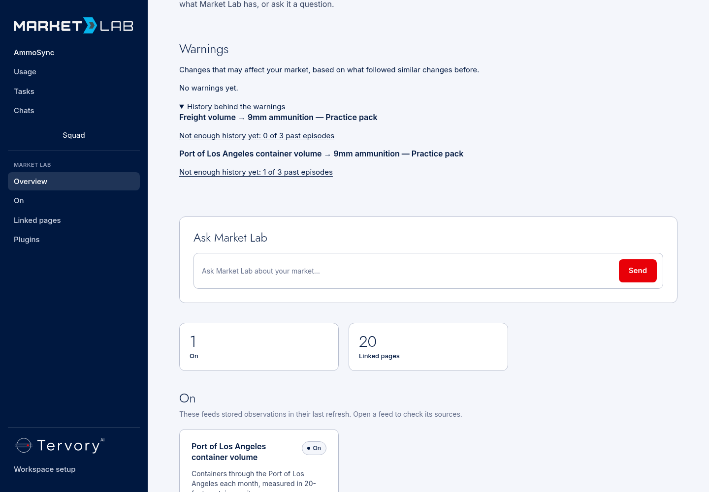
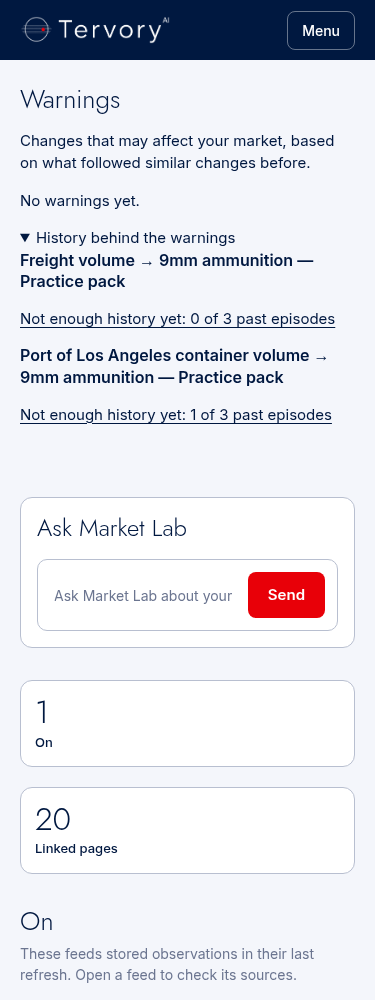
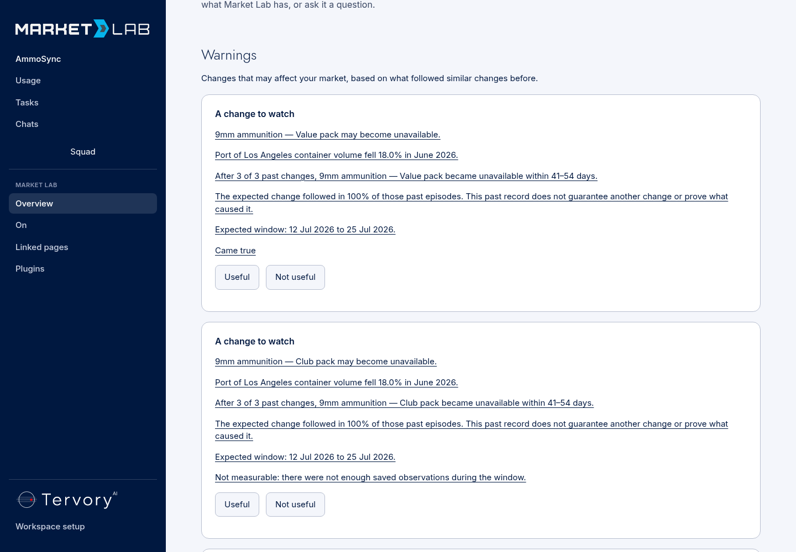
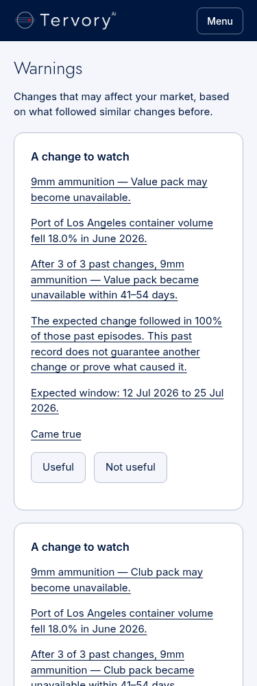
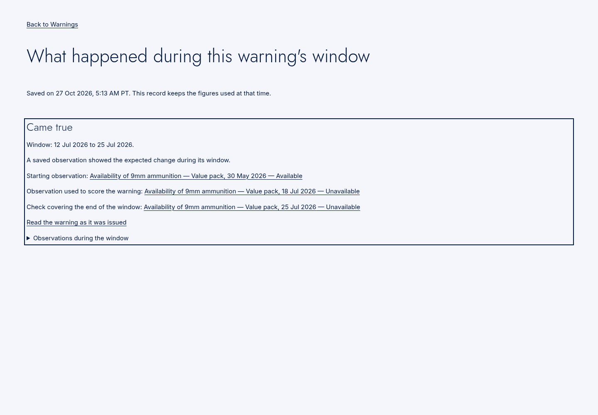
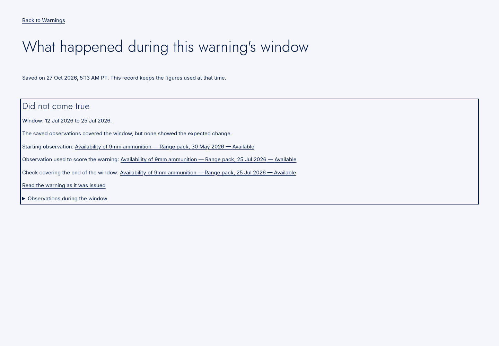
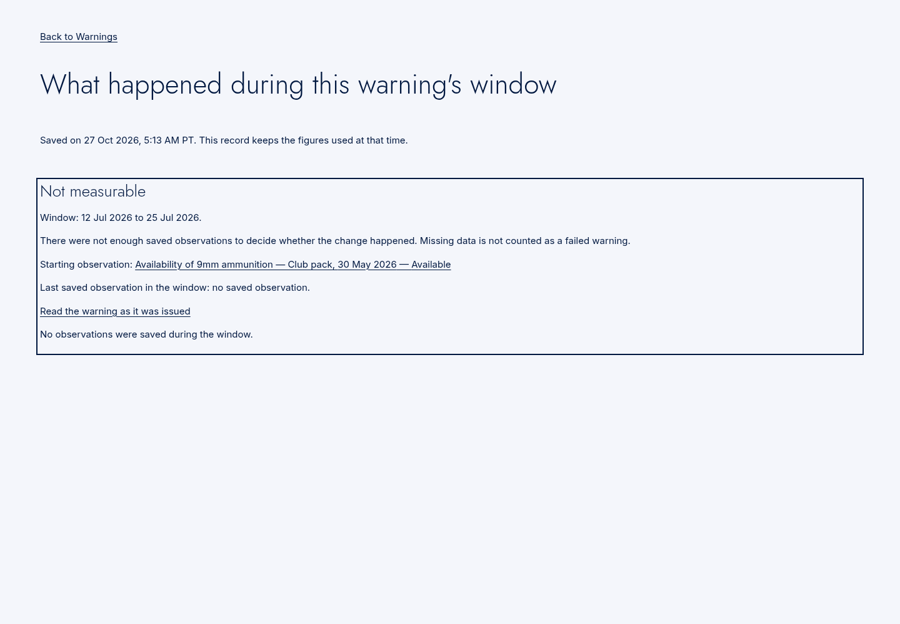

# Local warning proof, 27 October 2026

These captures use real Tank, Market Lab, Tiger and Postgres, with synthetic
external histories and local tenant selection. They do not show a signed-in
production account or prove a live relationship. [Reproduce from a fresh
clone](../../warning_proof/README.md). IDs and dates depend on the local run.

- [Real Tank startup and shutdown](services.log); [job receipt](job.json).
- [Offline tests](pytest.txt): 222 passed, 3 local database tests and 2 optional PDF-parser tests skipped,
  622 skill eval subtests passed.
- [Real Tank test](real-tank-pytest.txt): 1 passed.
- [CI lint command and additional module lint](lint.txt): passed.
- [Workspace production build](next-build.txt): passed.
- [Browser receipt](browser.json): 1440/375 px, five warning citations,
  both reactions at each width, three resolution states at each width,
  and zero browser errors. The raw observation links are opened and their
  target rows checked for presence and highlighting.

## Screenshots

*local, fixture page — shipping warning with every figure linked.*

*local, fixture page — warning on mobile.*

*local, fixture page — stored evidence behind the warning.*

*local, fixture page — one episode produces no warning.*

*local, fixture page — insufficient history on mobile.*

*local, fixture page — resolved warning cards.*

*local, fixture page — resolved warning cards on mobile.*

*local, fixture page — the stored outcome met the expected change.*

*local, fixture page — complete coverage without the expected change.*

*local, fixture page — missing observations are not called a failed warning.*
