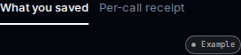
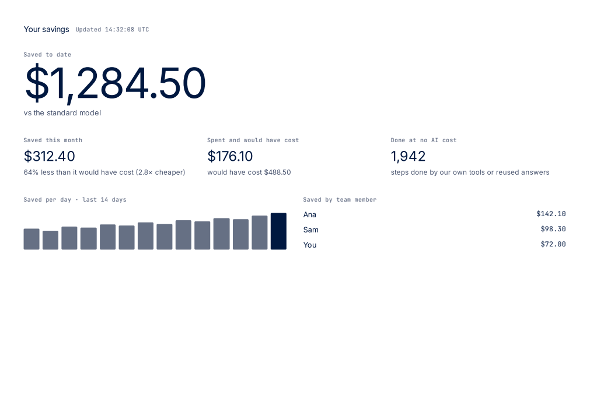
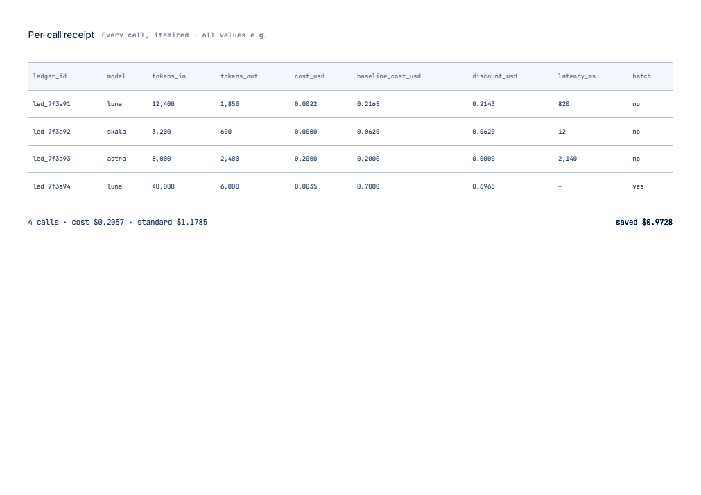

# Approved homepage build — browser review

Branch: `codex/homepage-build`. Base: `origin/main` at the start of this task.

Preview: <http://2.25.250.28:8916/>. The existing site server serves the production export on port 8916, with its signup store isolated at `/dev/shm/tervory-homepage-review-signups.jsonl`. Production has not been deployed or merged.

Source: [approved homepage frame 59:164](https://www.figma.com/design/bOSFzo7qMhHjJ6T5brXG1Y?node-id=59-164). The founder explicitly instructed: “please build it as is for now and I will decide the changes.” The illustrated prices, product placeholders, receipts and existing copy are retained under that instruction. They do not represent live model prices, real purchases or client account totals.

## Changes for the PR

| File and line | Change |
| --- | --- |
| `site/app/page.tsx:1` | Replaces the previous homepage with the approved navigation, hero, Engine, tracker copy, manifesto, Tisan, Rig, TRIGGER, ten-product squad, receipt and closing form. Uses the existing metadata source. |
| `site/app/home-copy.ts:1` | Verbatim wording extracted from the approved Figma frame, indexed by source node ID. |
| `site/app/home-interactions.tsx:25` | Five Engine stages, automatic progression, manual selection, keyboard tabs and stage inspector. Reduced-motion preference stops automatic progression. |
| `site/app/home-interactions.tsx:47` | Rig product → paired → market → matched → quote flow and five optional switches. The final “Accept & pay” button resets the illustration, matching Figma reaction 138:2298 → 147:2268. It never charges or places an order. |
| `site/app/home-interactions.tsx:65` | Savings/per-call receipt tabs, view-specific CSV downloads, and print-to-PDF styling/action. |
| `site/app/homepage.css:1` | Scoped dark homepage styling and responsive layouts; existing internal pages retain their original stylesheet. Fonts reuse the local Inter and JetBrains Mono files. |
| `site/app/release-form.tsx:7` | Reuses the existing signup handler and storage behavior, with the approved hero field/button labels as an optional presentation variant. Existing success/failure wording is retained. |
| `site/public/home/` | 27 original Figma assets stored locally, including the founder's original TRIGGER CRM and AUTUMBRA PNGs, hero image, product logos, dots and switch artwork. No temporary Figma asset URLs are used at runtime. |
| `site/check-homepage-browser.mjs:1` | Browser checks for interactive stages, keyboard navigation, switch state, loaded assets, exports, forms, automatic progression and four viewport sizes. |
| `site/check-public.mjs:1` | Updates old homepage assertions to the approved design and checks every rendered image slot has non-empty local and exported files. Keeps private-page exclusion checks. |
| `tests/test_site_homepage.py:1` | Updates the prior homepage regression check, retains metadata-source and retired-phrase checks, and prevents live API calls from the illustrations. |

The AUTUMBRA entry is included where it appears in the approved homepage squad. A separate eclipse illustration was not inserted as a new section: frame 59:164 has no such section. There are no model calls, payment integrations, new signup routes, runtime settings, secrets or production-data changes in this branch.

## Exact verification commands and results

Run from `/workspace/codex-homepage-build/site` unless a different directory is shown.

```sh
npm ci --ignore-scripts
```

PASS: 32 packages installed, 33 audited, zero vulnerabilities reported for this package.

```sh
npm run build
```

PASS: Next.js 15.5.28 production compilation, type checks and static export. Homepage: 5.02 kB route code / 108 kB first-load JS. Eleven static pages generated; internal pages remain excluded from public discovery.

```sh
TMPDIR=/dev/shm npm run check
```

PASS: `Public pages check passed.` and `Release store check passed.` Tests use a temporary signup store; they do not use production signups.

```sh
cd /workspace/codex-homepage-build
/home/ammosync/trigger-crm-venv312/bin/python -m pytest tests/test_site_homepage.py -q
```

PASS: `3 passed in 0.33s`.

```sh
cd /workspace/codex-homepage-build/site
TMPDIR=/dev/shm PLAYWRIGHT_MODULE=/tmp/tervory-job8-widget-resume/node_modules/playwright/index.mjs BROWSER_EXECUTABLE=/home/ammosync/.cache/ms-playwright/chromium_headless_shell-1248/chrome-headless-shell-linux64/chrome-headless-shell node check-homepage-browser.mjs
```

PASS: 22 image slots loaded with non-zero dimensions, all five Engine stages, keyboard selection, five Rig states and reset, all five switches, automatic Engine/Rig progression, four receipt rows, CSV contents/download, PDF print action/generated PDF, both form instances saving and existing failure state. Zero JavaScript errors. Page width did not exceed the viewport at 320, 375, 768 or 1440 pixels. Illustration controls issued zero POST requests.

```sh
git diff --check
curl -s -o /dev/null -w 'Preview HTTP %{http_code}\n' http://2.25.250.28:8916/
```

PASS: no whitespace errors; `Preview HTTP 200`.

Preview server command:

```sh
cd /workspace/codex-homepage-build/site
node server.mjs --port 8916 --file /dev/shm/tervory-homepage-review-signups.jsonl
```

Earlier checks and resolutions: system `python3 -m pytest` could not run because that interpreter lacks pytest; the existing Python 3.12 test environment above passed. `npm run check` with the default temporary directory failed to store a test address; the same check with `TMPDIR=/dev/shm` passed. Initial Figma downloads produced empty files on direct disk writes; every asset was downloaded through memory storage, copied into the repo and checked non-empty. The first browser keyboard test focused an inactive tab without selecting it; correcting the test's starting selection produced a passing keyboard check. These failures are not reported as passes.

## Browser evidence

These are screenshots from the agent's Chromium browser test of the actual production export, after all lazy images loaded. They are not screenshots from the founder's browser.


The 320/768 screenshots and example CSV/PDF are also available in `/dev/shm/tervory-homepage-proof/` on this review host.

## Remaining acceptance

The preview was queued to open in the founder's Codex browser panel. Founder browser acceptance and screenshots have not yet been received and are not claimed. Claude opens the PR from this branch under the founder's rule 12; the founder merges. No PR has been opened by Codex. The separate review thread's findings and founder acceptance remain pending.

## Review correction — receipt badge and PDF appearance

Fixed the reported 320px clipping in `site/app/homepage.css:259`: the receipt tab row now wraps with a 12px gap, and the Example badge cannot shrink. No wording changed. `site/check-homepage-browser.mjs:81` checks every tab and the badge against their container bounds at all four viewport widths. At 320px, the badge's right edge is 296px, equal to its container edge; all three elements fit.

PDF appearance is now visually verified, beyond the earlier file-generation check. Rendering the initial PDF exposed the dark homepage surround in print. `site/app/homepage.css:264` now sets a white print canvas, A4 landscape paper, 12mm margins, contrasting table headings and rules, and visible overflow. Both savings and per-call PDFs render as one readable page without clipping. These are agent browser/PDF checks, not founder acceptance.

Repeated after the correction:

```sh
cd /workspace/codex-homepage-build/site
npm run build
TMPDIR=/dev/shm npm run check
/home/ammosync/trigger-crm-venv312/bin/python -m pytest ../tests/test_site_homepage.py -q
TMPDIR=/dev/shm PLAYWRIGHT_MODULE=/tmp/tervory-job8-widget-resume/node_modules/playwright/index.mjs BROWSER_EXECUTABLE=/home/ammosync/.cache/ms-playwright/chromium_headless_shell-1248/chrome-headless-shell-linux64/chrome-headless-shell node check-homepage-browser.mjs
```

PASS: production build; public-page and signup-store checks; `3 passed in 0.32s`; full browser workflow checks plus the new receipt-bounds assertions. An initial browser rerun was interrupted when the preview process stopped; the preview was restarted with the documented isolated-store command, and the complete rerun passed.

PDF review tooling was isolated under `/dev/shm`, with no project/runtime dependency added:

```sh
/home/ammosync/trigger-crm-venv312/bin/pip install --disable-pip-version-check --no-cache-dir --target /dev/shm/tervory-pdf-review pypdfium2 pillow
```

Playwright generated each receipt view with `page.pdf({ printBackground: true, preferCSSPageSize: true })`. PDFium opened both actual PDF files, confirmed one page each, and rendered them with `page.render(scale=1.2).to_pil().save(...)`. The resulting images were visually inspected:







Nothing merged or deployed. Founder browser acceptance remains pending.
