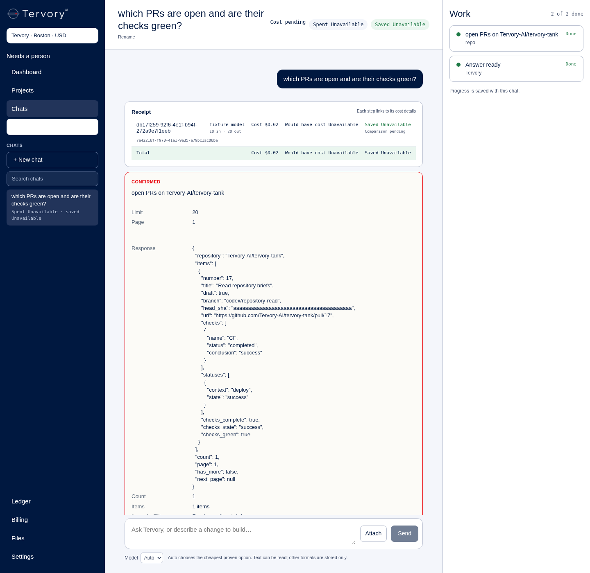

# Founder repository read tools

Branch: `codex/command-repo-tools`, from `origin/main` at `4e74b42`.

## Scope

The founder's chat could not read repository briefs, PRs or CI results. This
adds `repo.prs`, `repo.pr` and `repo.file` to Tank's existing founder tool plumbing.
The fixed repository is `Tervory-AI/tervory-tank`. Outbound reads use only GET at
`https://api.github.com`; file reads use main and allow only `docs/**` or `.md`
files. No writes, redirects to another host, new page text or model calls for
repository reads. An empty `TANK_GITHUB_READ_TOKEN` hides and disables the tools.

The setting is documented by name only. Grok creates it; the founder supplies
its fine-grained read-only value. This build does not create, inspect or use a
real token. Tests use an offline GitHub stub. Remote operations by the builder
use git only. Claude opens the PR; the builder does not call GitHub's API.

## Proof status

Implementation and offline verification are complete. **The founder's live
acceptance test is pending; this is not a live-done claim.**

Offline verification uses a socket-free `httpx.MockTransport` for GitHub and an
isolated local Postgres. The existing Command tests and actual Tank boot test
also run: **161 passed**, no skips, with five existing FastAPI lifespan
deprecation warnings (38.00 seconds).

```sh
POOL_SCHEMA_DATABASE_URL=postgresql://postgres@127.0.0.1:55439/postgres /tmp/command-repo-venv/bin/python -m pytest -q tests/test_command_repo_tools.py tests/test_command.py tests/test_tank_boots.py tests/test_secrets.py --tb=short
```

The new tests prove founder-only discovery and dispatch, clients in two tenant
contexts denied, empty-setting/revoked-founder checks before Confirm, GET-only
routes/transport, fixed repository and main ref, path/symlink/submodule refusal,
checks plus legacy statuses, pagination without following remote Link URLs,
sanitized failures, and confirmed results persisted/replayed only to their owner.
The actual Tank starts twice against an empty local database.

`tank/command.py:41` adds the founder tools; `:94` gates discovery;
`:738` defines argument schemas and authenticated GET handlers; `:889` registers
the existing command adapters. `tank/command_repo.py:19` fixes the repository
and endpoint allowlist; `:42` manages the runtime client; `:54` permits only GET;
`:95` reads head checks/statuses; `:131` lists PRs; `:145` reads files changed in
a PR; `:159` reads main through Git tree modes and blob hashes.
`.env.example:34` and `docker-compose.yml:211` add the empty setting by name.
`tank/Dockerfile:5` includes the new helper in the Tank image.
`tests/test_command_repo_tools.py:115` starts the access tests, `:184` the path
tests, `:219` the check-status tests and `:296` the confirmed-read persistence
and tenant-isolation test. `tests/command_repo_tools/browser.cjs:1` renders the
saved integration-test snapshots through the existing CommandWindow.

The UI is unchanged. Results use its existing Response field; this includes
the complete requested page rather than relying on the five-item preview.
Every read retains the existing Confirm action. Checks are for the PR's head
commit and include both check runs and legacy commit statuses; missing or
incomplete checks are unknown, never green. This does not assert mergeability
or that every branch-protection requirement is satisfied. PR/file pagination
returns `has_more` and `next_page`. File content is UTF-8, at most 64,000 bytes;
binary files, symlinks, submodules and truncated tree responses are refused.

```sh
/tmp/command-repo-venv/bin/ruff check tank tests --select E9,F --per-file-ignores 'tank/skills/base.socials/1.0.0/run.py:F401'
git diff --check
/tmp/command-repo-venv/bin/python -m pytest -q tests/test_secrets.py --tb=short
```

Results: all lint checks passed with the pinned Ruff 0.17.2; no whitespace
errors; both secret-scan tests passed. The new suite also passes separately:
83 passed (3.60 seconds).

## Offline browser proof

```sh
POOL_SCHEMA_DATABASE_URL=postgresql://postgres@127.0.0.1:55439/postgres COMMAND_REPO_SNAPSHOT=/tmp/command-repo-snapshot.json /tmp/command-repo-venv/bin/python -m pytest -q tests/test_command_repo_tools.py --tb=short
COMMAND_TEST_TOOLS=/tmp/rig-works/browser/node_modules COMMAND_REPO_SNAPSHOT=/tmp/command-repo-snapshot.json node tests/command_repo_tools/browser.cjs
```

The first command saved the actual pending and confirmed thread snapshots from
the new integration test. The second used already-installed esbuild 0.25.12,
Playwright 1.64.1, `/usr/bin/chromium` and the existing Workspace dependencies.
Its output was:

```text
PASS: existing Confirm, complete PR/check result visible, reload persists, one confirmation, no browser errors or external requests. Screenshot is offline stub data only.
```



This screenshot is **local offline proof only**, not the founder's live browser.
The integration test stubs only the planner answer and GitHub transport; it uses
the existing Command identity, confirmation, in-process HTTP dispatch and actual
Postgres persistence. The browser replays those saved snapshots through the
unchanged presentation/component and clicks the existing Confirm button. No
model or live GitHub call was made to test the work.

## Reproduce the test environment

Python 3.12.14; the venv is `/tmp/command-repo-venv`. The setup commands used were:

```sh
UV_CACHE_DIR=/tmp/command-repo-uv uv venv /tmp/command-repo-venv
UV_CACHE_DIR=/tmp/command-repo-uv uv pip install --python /tmp/command-repo-venv/bin/python fastapi==0.162.0 starlette==1.10.0 pydantic==2.10.6 httpx==0.28.1 asyncpg==0.30.0 pytest==9.1.1 pytest-asyncio==1.4.1
UV_CACHE_DIR=/tmp/command-repo-uv uv pip install --python /tmp/command-repo-venv/bin/python -r tank/requirements.txt
UV_CACHE_DIR=/tmp/command-repo-uv uv pip install --python /tmp/command-repo-venv/bin/python ruff==0.17.2
env -u DOCKER_HOST -u DOCKER_CONTEXT -u DOCKER_TLS -u DOCKER_TLS_VERIFY -u DOCKER_CERT_PATH docker --host=unix:///var/run/docker.sock run --detach --rm --name command-repo-postgres --publish 127.0.0.1:55439:5432 --env POSTGRES_HOST_AUTH_METHOD=trust postgres:16.15
```

All completed successfully. This database is disposable, local to the cloud
workspace, uses no password, and has no production data. Tests create/drop their
own databases. Browser tools were reused from the existing temporary install;
the harness accepts another package directory through `COMMAND_TEST_TOOLS`.

Earlier attempts: minimal-dependency Command run: 17 passed, 26 skipped,
32 missing-`redis` import errors; resolved by the full Tank requirements and
local database above. New-suite draft: 60 passed, four incorrect assertions
about the existing list-shaped tools response; corrected. Ruff 0.15.0 flagged
fixture-import F811 issues; the pinned 0.17.2 passes. Expanded-suite draft:
82 passed, one test comparing httpx QueryParams directly to a dict; corrected.
The final commands/results above supersede those attempts.

## Live acceptance still required

Grok creates `TANK_GITHUB_READ_TOKEN` on Tank; the founder fills its value.
It must be a fine-grained token limited to `Tervory-AI/tervory-tank`, with
Contents, Pull requests, Checks and Commit statuses set to read-only. No value
was created, read or used by this build. Empty configuration offers no repo tools.
Deployment, the real token-backed answer and the founder's screenshot are still
missing. Claude opens the draft PR; this builder used git fetch/push only and
did not call the GitHub API or open a PR.

After deployment and configuration, open **https://app.tervory.com/chats** as
the founder, send:

> which PRs are open and are their checks green?

Click the existing **Confirm** button on the repository read card. Its response
must show the real PR numbers, titles, draft flags, branches and head check
results. If `has_more` is true, request `next_page` and confirm that read. Reload
the thread to confirm the result remains visible. Add the founder's actual
screenshot and observed result here; only then assess the live done condition.
