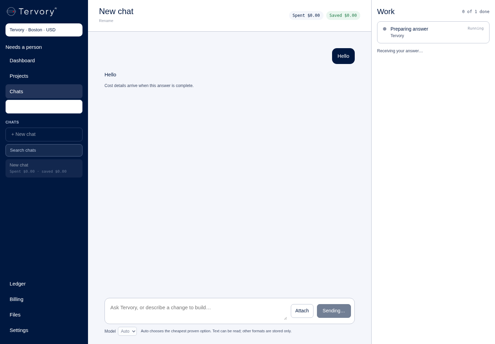
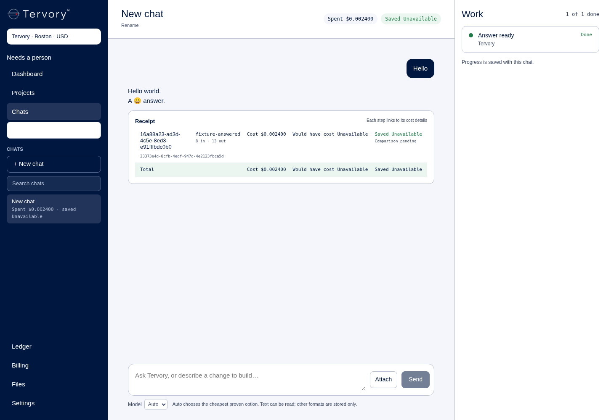
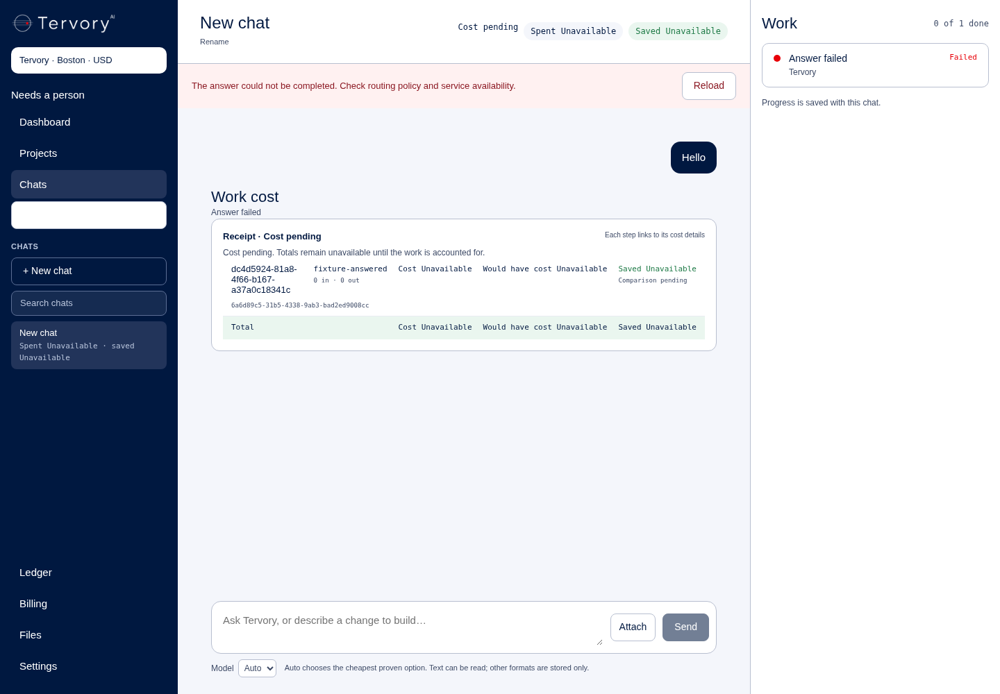

# Stream Command answers through the existing chat

Branch `codex/command-streaming`, from `origin/main` at `2929886`.

The Command route waited for the full model answer before sending its
single text event. This change forwards LiteLLM streaming output into the
existing SSE path and message bubble, retaining the shared router's policy,
tenant cache, ledger, receipts, tool validation and Confirm/Cancel actions.

Scope: Tank's command turn and the shared router's model transport for that
turn, the existing Workspace stream handling, and offline tests/proof here.
No new interface wording, provider, credential or model call to check work.
Claude opens the PR; remote work by this builder uses git only, never GitHub API.

## Proof status

Implementation and offline verification are complete. **The founder's live
acceptance check is still pending; this is not a live-done claim.**

Tank uses OpenAI SDK 2.54.0 against the existing LiteLLM URL, with retries and
redirects off. The SDK decodes SSE; there is no custom provider client.
LiteLLM's built-in `include_cost_in_streaming_usage` is enabled in both regional
configs; its final `usage.cost` enters the existing ledger path. No price is
estimated. Cache/code hits still return whole without opening a model stream.
Only terminal usage counts; interim usage cannot make an incomplete stream
successful. Jiter previews only the plan's text field; the whole plan is validated before
cards are proposed. Actions still wait for the existing Confirm/Cancel controls.

Only provisional token events are written during generation. Completed messages
and successful receipts are saved after stream completion. Broken streams keep
the existing failed step/error and failed-call accounting: an unknown charge is
marked `not_set` using the existing ledger convention, never displayed as $0.
The Workspace uses the same message bubble and wording, cancels the upstream
reader on disconnect, and removes interrupted previews even if refresh fails.

```sh
set -o pipefail
POOL_SCHEMA_DATABASE_URL=postgresql://postgres@127.0.0.1:55440/postgres COMMAND_TEST_TOOLS=/tmp/rig-works/browser/node_modules /tmp/command-repo-venv/bin/python -m pytest -q tests/test_command.py tests/test_command_repo_tools.py tests/test_command_streaming.py tests/test_tank_ladder.py tests/test_tank_boots.py tests/test_secrets.py tests/test_model_roster.py tests/command_streaming/browser_proof.py --tb=short | tee tests/command_streaming/pytest.txt
```

Final result: **200 passed**, no skips, five existing FastAPI deprecation warnings
(79.25 seconds). Output is saved in [pytest.txt](pytest.txt), with trailing
whitespace removed from warning lines.
These cover the actual SDK with a stub transport, Tank
over local HTTP, real isolated Postgres, and two complete Tank startups. No
GitHub API, live provider, production database or paid model is used.

```sh
/tmp/command-repo-venv/bin/ruff check tank tests --select E9,F --per-file-ignores 'tank/skills/base.socials/1.0.0/run.py:F401'
git diff --check
node tests/command_1b_contract.cjs
node tests/command_1b_pages.cjs
node workspace/node_modules/typescript/bin/tsc --noEmit --project workspace/tsconfig.json
node workspace/node_modules/typescript/bin/tsc --noEmit --allowImportingTsExtensions --project workspace/tsconfig.json
```

Lint, whitespace, both existing Command contract/page suites and the last
diagnostic TypeScript command pass. **Standalone `tsc` is blocked**
by the unchanged `workspace/app/tiger/plugins-data.test.ts:3` import of
`./plugins-data.ts` (TS5097). The same import is on main at `2929886`; no Tiger
file or project compiler setting is changed in this chat task.

The production build also passed, including Next's application type check and
all 37 static pages. Exact command, from `workspace/` (the same inert public
test values as CI):

```sh
NEXT_TELEMETRY_DISABLED=1 NEXT_PUBLIC_CLERK_PUBLISHABLE_KEY=pk_test_ZHVtbXkuY2xlcmsuYWNjb3VudHMuZGV2JA== CLERK_SECRET_KEY=sk_test_dummy npm run build
```

It compiled successfully in 14.9 seconds and completed standalone output.
No compiler configuration or Tiger file was changed to obtain this result.

## What changed

| File and line | Change |
| --- | --- |
| `tank/command.py:379` | Pass the private token callback into the shared router. |
| `tank/command.py:405` | Write ordered, owner-scoped provisional text events; save the final answer, receipt and cards in the existing completion transaction. |
| `tank/command.py:541` | Cancel an unfinished model turn when its owning stream closes. |
| `tank/command_stream.py:39` | Use the standard SDK against LiteLLM, require finish plus final measured usage, and normalize completed output for the existing accounting path. |
| `tank/command_stream.py:86` | Preview the plan's answer text with the SDK's JSON parser dependency, including split Unicode escapes. Never stream tool arguments. |
| `tank/main.py:1070` and `:1224` | Add the private callback and select streaming only for `command.turn`, after the same guards and cache lookup. |
| `tank/main.py:1234` | Record failed streams as failed calls; mark unknown charges `not_set` under the existing NOT NULL ledger convention. |
| `litellm/config.yaml:642`, `litellm/config.za.yaml:660` | Enable LiteLLM 1.106.4's built-in final `usage.cost` from its configured pricing. |
| `tank/requirements.txt:8`, `tank/Dockerfile:5` | Pin SDK/parser dependencies and ship the helper. |
| `workspace/app/chats/contract.ts:24` | Cancel an SSE reader through an abort signal. |
| `workspace/app/chats/api/[...path]/route.ts:101` | Propagate cancellation and avoid writing into a closed proxy stream. Existing role projections remain in place. |
| `workspace/app/chats/window.tsx:130`, `:216`, `:223` | Keep growing text visible, handle whole/cache or corrected final text, and remove interrupted local previews. No markup, styling or page wording changes. |
| `tests/test_command.py:978` | Let the existing accounting test stub accept the new callback. |
| `tests/test_command_streaming.py:178` | Prove early ordered tokens and no saved assistant/receipt/ledger before model completion. |
| `tests/test_command_streaming.py:212`, `:236` | Prove buffered/streamed receipt and ledger parity, model-pin behavior and whole tenant cache hits. |
| `tests/test_command_streaming.py:256`, `:280`, `:302` | Refuse truncated, errored, unpriced, unfinished and interim-usage-only streams; test disconnect, no redirect and no retry. |
| `tests/test_command_streaming.py:315`, `:334` | Refuse foreign tenants/users and preserve founder-only pending cards and cancellation. Existing Command/repo tests also cover Confirm and dispatch. |
| `tests/command_streaming/browser_proof.py:16`, `browser.cjs:1` | Test the actual Workspace proxy and CommandWindow against local Tank in Chromium. |

The paid transport is the only change inside `run_route`: its policy, guards,
cache identity/read/write, successful ledger/transcript logic and graduation
path are retained. A cache or code answer never opens a provider stream.

## Offline browser evidence

```sh
POOL_SCHEMA_DATABASE_URL=postgresql://postgres@127.0.0.1:55440/postgres COMMAND_TEST_TOOLS=/tmp/rig-works/browser/node_modules /tmp/command-repo-venv/bin/python -m pytest -q -s tests/command_streaming/browser_proof.py --tb=short
```

All four cases pass: [complete](browser-complete.txt), [broken](browser-broken.txt),
[broken with a failed refresh](browser-broken_refresh.txt), and
[browser disconnect](browser-disconnect.txt). The tests pause the stubbed model
until Chromium shows the first text; Python checks that no completed message or
receipt exists, then releases it. They use the real Workspace SSE handler and
server-side Tank client, real CommandWindow/presentation, actual Tank router,
SDK and Postgres. Only authentication and the model transport are test seams.
Browser external requests are blocked and asserted absent.

These screenshots are **cloud-local offline fixtures, not a live founder test**.







## Test setup and operational limit

Python 3.12.14 and the existing `/tmp/command-repo-venv` were reused. Tank's pinned
requirements, pytest 9.1.1, pytest-asyncio 1.4.1 and Ruff 0.17.2 are installed.
The added runtime pins are `openai==2.54.0` and `jiter==0.18.0`. Chromium is
`/usr/bin/chromium`; the reused temporary Node tools are esbuild 0.25.12 and
Playwright 1.64.1. `COMMAND_TEST_TOOLS` can select another installed directory.
The database was started with:

```sh
env -u DOCKER_HOST -u DOCKER_CONTEXT -u DOCKER_TLS -u DOCKER_TLS_VERIFY -u DOCKER_CERT_PATH docker --host=unix:///var/run/docker.sock run --detach --rm --name command-streaming-postgres --publish 127.0.0.1:55440:5432 --env POSTGRES_HOST_AUTH_METHOD=trust postgres:16.15
```

Each test creates/drops its own database. This uses no password or production
data. The SDK versions were resolved and installed through the package manager;
LiteLLM's pinned 1.106.4 source package was inspected to verify the existing cost
option. No secrets were created, inspected or added.

Deployment must include Tank **and the regional LiteLLM config** so terminal
stream usage contains cost. Missing final usage/cost is a failed turn with
unknown-charge accounting; it is never guessed to be free. Live deployment,
CI status and the founder's actual screenshot are not claimed by offline proof.

During test development, one existing stub needed the callback parameter, the
browser proof module was renamed to avoid shadowing `tank/proof.py`, and two
browser assertions were corrected to include the existing Reload button text.
The final proof commands above exercise the corrected tests.

## Founder test after deployment

Claude opens the draft PR. The founder's actual live observation and screenshot
are still required before calling this done.

Open **https://app.tervory.com/chats** as the founder. Start a new chat, type a
question that is not already cached, and click the existing **Send** button.
Watch the same answer bubble grow while **Preparing answer** remains in the
steps panel. At completion, check the receipt appears once, click its existing
cost-detail link to verify the ledger, and reload to confirm the same answer and
receipt are saved. Ask the identical question again: its cache hit should arrive
whole with the existing zero-cost receipt. Attach the founder's live screenshot
and observed result here.
