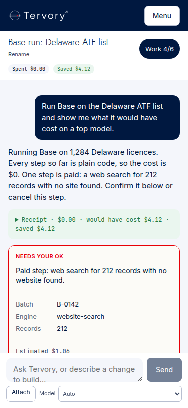
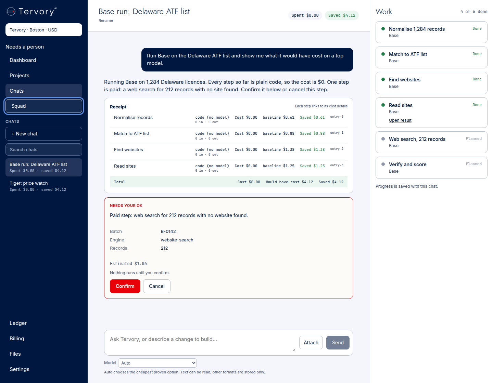

# COMMAND-1 Lane B audit, 31 October 2026

Evidence time: 2026-10-31 02:02 PDT / 09:02 UTC. This is an offline audit of existing behavior, not founder acceptance or visual approval. No model calls, real credentials, production requests, production SQL, worker investigation or ZA operations were used.

## Prioritized completion matrix

| Requirement | Existing implementation / evidence | Remaining boundary |
| --- | --- | --- |
| P0 trusted tenant/user/role | `command_1b_contract.cjs`: server-derived identity; forged browser identity and squad stripped; denied tools and forged client pins rejected | Actual backend enforcement and assembled browser run depend on A / acceptance lane |
| P0 Confirm/Cancel does nothing early | Browser asserts no card calls before Confirm; cancel, safe retry and lost-confirmation guard survive reload | Real action execution/receipts require A; no live execution claimed |
| P0 exact receipts per turn/header | `receiptFor` and `applyReceipt` aggregate each step's rows, deduplicate ledger IDs, keep missing/invalid totals unavailable; browser checks pending header | Actual ledger provenance handled by A; founder comparison to live rows pending |
| P0 Auto comparison | Pinned rows carry Tank's same-token Auto comparison (#224, restored on #496); `receiptFor` totals it only when every row is priced | Price-book comparison, labelled as such; not a second model run |
| P1 streaming/reconnect | Existing real stream parser + duplicate sequence guard; one replay GET after interrupted answer, no repeated turn POST | Recovery is bounded; incomplete replay uses existing error and authoritative snapshot. No unbounded reconnection claim |
| P1 replay sequence | A adds atomic snapshot seq; B seeds cursor from snapshot and advances on received events | Assembly at exact heads is acceptance lane's work |
| P1 list/new/rename/search/persistence | Existing browser tests exercise new chat, rename, title search and reload; dashboard prompt consumed once | Search currently filters loaded titles only, not full message history/all backend threads |
| P1 files remain local | Existing proxy passes fixed same-box Tank identity; text and bounded binary upload/download exercised offline | Real regional storage/isolation belongs to A; no ZA operations performed |
| P1 work panel steps/status/artifact links | Existing browser covers panel/focus/status/result links, updates via events/snapshot | Direct real worker-to-PR proof belongs to acceptance/backend lanes |
| P1 Auto/roster picker | Existing client Auto-only and founder roster/pin error tests pass | Actual routing/ledger proof belongs to A; no model calls to check work |
| P1 CI | Local contract/page/type/build/browser checks below | Remote checks and independent review required before ready |
| P2 375px/1440px | Offline screenshots below render actual component with synthetic HTTP fixtures | Not founder screenshots; legacy Figma 3:2/4:84/4:114 were rejected. Current approved Chats frame/exact text missing; Grok owns design |
| Founder sees it work | Not claimed | Founder browser acceptance last, after assembly/deployment |

## Reproduction and results

The existing dependencies were reused: `workspace/node_modules` symlinked temporarily to `/tmp/tervory-base-437-origin/workspace/node_modules`. `/tmp/command-workspace-tools/node_modules/esbuild` points to `/tmp/tervory-dashboard-test-tools/node_modules/esbuild`; its `playwright` points to `/tmp/tervory-job8-widget-resume/node_modules/playwright`. These links are not committed.

| Exact command | Result |
| --- | --- |
| `node tests/command_1b_contract.cjs` | PASS: identity/CSRF/role, uploads/downloads, SSE, pending receipts, mixed-step/delta/dedupe/null/NaN/Infinity and legacy Auto projection checks |
| `node tests/command_1b_pages.cjs` | PASS: existing dashboard handoff, client Auto, founder roster, authoritative/empty/unavailable catalogue |
| `./workspace/node_modules/.bin/tsc --noEmit -p workspace/tsconfig.json` | PASS, exit 0 |
| `npm run build` (cwd `workspace`) | PASS, exit 0; Next 15.5.28 compiled, checked types and generated 38 static pages |
| `COMMAND_TEST_TOOLS=/tmp/command-workspace-tools/node_modules COMMAND_BROWSER=/opt/google/chrome/chrome COMMAND_TEST_OUTPUT=/tmp/command-workspace-final node tests/command_1b_browser.cjs` | PASS: actual component, desktop/mobile layout, lifecycle, Confirm/Cancel, lost confirmation, attachments, roles, stream dedupe, one-GET recovery, 500-event incomplete replay + saved snapshot, still-active replay, explicit error without replay, and transport failure before headers without turn retry |

An initial invocation used absent `python` and failed before editing; corrected to `python3`. Initial git commit lacked local author identity; corrected using repository-local Codex identity. No fetch/push failed. `gh pr edit` failed due deprecated classic-project GraphQL fields; PR body updated with `gh api --method PATCH ... --input` instead. These failures are not presented as successful checks.

## Screenshot provenance

Both screenshots below were captured from the **offline synthetic harness**, not app.tervory.com or the founder's browser. Their displayed amounts and sample conversation are test fixtures only, never live evidence. They document existing layout; they do not approve it. No UI copy, styling or layout was added by this PR.

