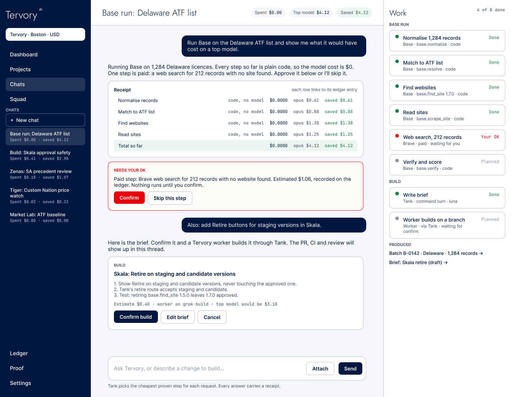
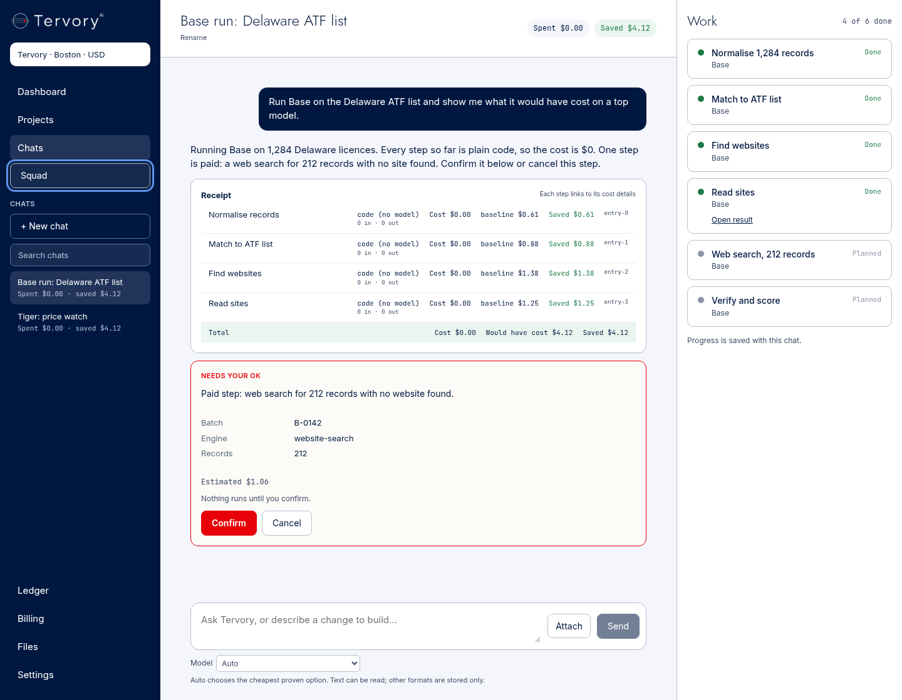
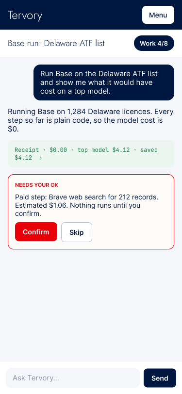
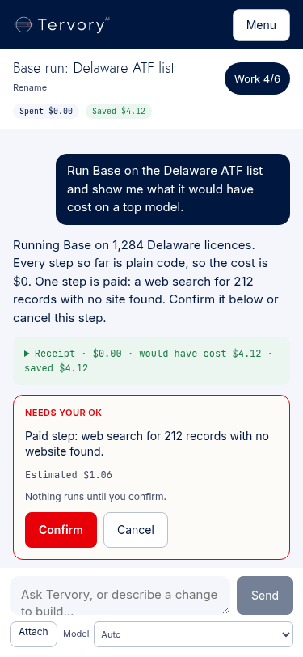
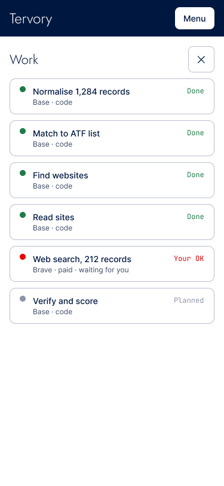
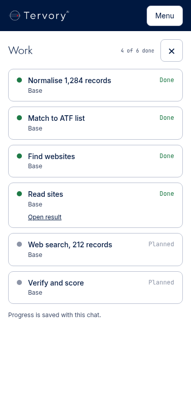

# COMMAND-1B evidence

The screenshots render the actual `CommandWindow` with synthetic HTTP responses, local brand files and local fonts in cloud Chromium. They do not claim a production or paid run.

| Approved Figma | Implementation |
| --- | --- |
|  |  |
|  |  |
|  |  |

[Client Auto-only view with unchanged conversation/result text](client-auto-375.png), [action states at 1440px](compatibility-1440.png), [pending costs after reload](pending-375.png), and [stored-only attachment with a founder pin error](attachments-375.png).

Reference: https://www.figma.com/design/ZnphBOJU6657tohGLD3IzS?node-id=3-2

## Review corrections

Applied https://github.com/Tervory-AI/tervory-tank/pull/225#issuecomment-6321562587:

- `/` is DASH-1's dashboard exactly as on main, except its ask action redirects to `/chats?ask=<text>`. `/chats` consumes that prompt once, creates one thread and sends its first message. Reload does not send again. Dashboard links return clients to `/` and founders to `/control`.
- `tests/dashboards-ui.cjs` is restored unchanged from main and still tests DASH-1. Page-boundary tests live separately in `command_1b_pages.cjs`.
- User/answer text, thread titles, filenames, target arguments and result text are preserved. Only generated interface labels (steps, actors, card titles) and model metadata are filtered for clients. Streaming token text is forwarded unchanged.
- Command identity is carried only in server-derived headers, with no `tenant_id` or `user_id` query parameters. Browser squad assertions are stripped.
- Clients receive Auto only, enforced in server page props, the picker, outgoing turns and the proxy. Founders retain roster choices and prices.

## Merged Lane A integration

Inspected main `7f938d4e8fb439454b9394cc918f307eaaee468d`, which includes #224. Lane A resolves the founder-controlled `tank.tenant_squad` table during authentication and rechecks authorization before dispatch. `/v1/command/tools` returns that identity's allowed tools. The same-box helper reads this catalogue; client navigation and confirmation controls use it. An empty list means chat only; a failed catalogue read disables tool controls while retaining chat and a visible error. No browser value creates a grant. Founder grant administration remains Lane A's existing `/control/squads` surface.

Text attachments remain `{name,text}` (200,000 characters); binary formats use bounded raw uploads and `{attachment_id}` turn references. Both direct and saved message-file download URLs retain ownership checks and attachment-only/no-store/nosniff headers. Binary content is labelled stored only, unreadable by the text router. Selection limits remain five files/5 MiB; A enforces the per-thread 20-file/20-MiB limit.

Pending receipt status and step IDs survive projection and reload. Empty costs remain unknown, comparison-pending states remain visible, and SSE deltas retain earlier evidence. Cards retain targets, results, execution/error states, and conservative retry behavior. Unknown outcomes never offer retry; a failed card requires explicit `retry_safe: true`. Lost confirmations remain uncertain across browser-session reloads.

## Cloud reproduction

- `node tests/command_1b_contract.cjs`: actual helper/proxy with mocked authentication and network, including exact text, Auto enforcement, trusted identity, tool catalogue/denial, CSRF, files, SSE, pending receipts and safe retries.
- `node tests/command_1b_pages.cjs`: real dashboard ask action, client/founder model props, and enabled/empty/unavailable tool catalogue behavior. Both command scripts run through the pytest wrapper in CI.
- `node tests/dashboards-ui.cjs`: unchanged DASH-1 dashboard coverage.
- With `esbuild` and `playwright` in a temporary cloud directory, set `COMMAND_TEST_TOOLS` to its `node_modules` and run `node tests/command_1b_browser.cjs`. It uses cloud Chromium at `/usr/bin/chromium`; no production endpoint or credential is used. It checks mobile/desktop layout, focus, navigation, files, streams, confirmations, Auto-only clients, tool grants and the one-time dashboard handoff.

## Live proof after founder deployment

Open `/` and verify DASH-1's dashboard. Submit “Explain gold prices & Tank evaluation?” in the ask box: one new `/chats` thread must contain the exact first message and unaltered answer. Reload must not resend it. Dashboard links must return clients to `/` and founders to `/control`.

With a client account, inspect Auto-only selection and rejection of a forged pinned turn. The founder can enable a squad in Lane A's existing controls; the corresponding `/chats` tool controls become available from `/v1/command/tools`. An empty list exposes no command tool controls. Revocation must be enforced by A even if a browser retains an old catalogue.

Send text and binary attachments, reload and download both; other users/organizations and cross-thread references must be denied. Compare `/chats/evidence/{thread}` with the same thread's events and tenant-scoped cost rows. Pending costs remain unavailable. Confirm/cancel separate cards, inspect results, and verify unknown outcomes offer no retry. Check the flows at 375px and 1440px.
