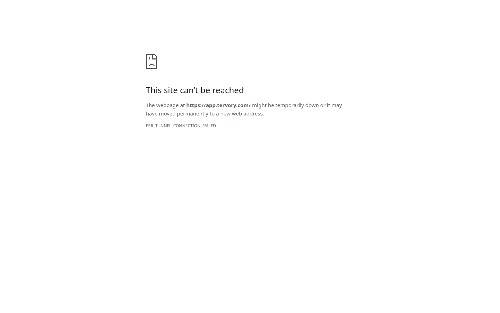
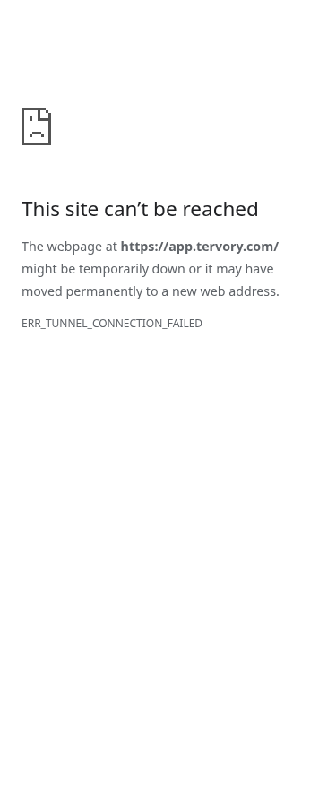

# LIVE-CHECK-1: signed-out live checks after deploy and every 30 minutes

Job 7, step 1 only. Started fresh from main `4e74b42` on
`codex/live-check-1`. Claude opens the draft PR; the founder merges.

**Implementation is ready for review; live acceptance is blocked.** The cloud
browser could not navigate to any of the 12 hosts. The app screenshot shows
`ERR_TUNNEL_CONNECTION_FAILED`. All 24 screenshots were saved. These are connection
failure screenshots, not proof that the live products loaded or that Rig's banned
catalogue was detected. No founder-browser or first GitHub run is claimed.

Job 6 is merged. Job 5 (#361) is unmerged, so Rig is expected to fail once reachable.
The checker has no exception that turns an expected product failure green.

## What changed (file and line)

| File | Line | Change |
| --- | --- | --- |
| `ops/live_check.mjs` | 18 | Loads the actual TypeScript host exports with Node's built-in type stripping; checks the map, app and Rig, including autumbra automatically. |
| `ops/live_check.mjs` | 41 | Uses existing Playwright Chromium with fresh signed-out storage for every host and viewport. |
| `ops/live_check.mjs` | 53 | Detects runtime exceptions, console uncaught errors, page crashes, HTTP 5xx, load timeout and visible banned text. Navigation has a 30-second ceiling. |
| `ops/live_check.mjs` | 84 | Saves full-page 1440px and 375px screenshots, including failures, then per-host JSON and a Markdown pass/fail table. Any failure exits 1. |
| `ops/live_check_banned.txt` | 1 | One case-insensitive literal-text list containing every marker in the brief. |
| `.github/workflows/live-check.yml` | 3 | Scheduled every 30 minutes, manually runnable, reusable after deploy, with offline-only PR checks for affected files. |
| `.github/workflows/live-check.yml` | 28 | Ubuntu latest, Node 22, existing npm/browser cache pattern and Playwright 1.64.1; installs Chromium only if a system browser is absent. |
| `.github/workflows/live-check.yml` | 67 | After deploy, polls the existing Coolify read helper until main and agent-rig explicitly report running:healthy; times out red after 10 minutes. |
| `.github/workflows/live-check.yml` | 110 | Uploads screenshots/results even when the page check fails, and links them from the GitHub run summary. |
| `.github/workflows/live-check.yml` | 135 | Reuses watchdog GitHub issue methods to open/update one incident per failed host with run/artifact links; serializes production runs to avoid duplicates. |
| `.github/workflows/deploy-on-merge.yml` | 50 | Adds only the second job, dependent on successful deploy, calling the reusable check with the health gate enabled. Existing deploy job is unchanged. |
| `tests/test_live_check.py` | 28 | Runs workflow health/issue snippets with offline mocks; verifies healthy readiness, refusal of unknown/missing apps and issue update without duplication. |
| `tests/test_live_check.py` | 113 | Serves good, crash, banned, delayed, failing HTTP, runtime-error, mobile-only and cookie-isolation pages on loopback; runs the real Chromium checker. |
| `tests/live_check_1/` | — | Explicitly requested PR description, command outputs and cloud live-attempt screenshots. No fixture is added to a live page. |

## Verification commands and results

All commands ran in the managed cloud workspace `/workspace/tervory-tank`.
No founder laptop, SSH, model calls, production writes, deployments or real secret
values were used. No GitHub API requests were made from this workspace. The future
Actions failure reporter uses the existing watchdog client as required by the brief;
only its mocked version was executed here.

### Setup and checkpoints

```sh
git fetch origin main
git switch -c codex/live-check-1 origin/main
npm install --prefix /workspace/live-check-browser --cache /workspace/scratch/npm-cache --no-audit --no-fund playwright@1.64.1
```

Fetch/switch succeeded. npm installed 2 packages: [output](npm-install.txt).
System Chromium was already available at `/usr/bin/chromium`; Node is v24.19.0 in
this cloud workspace. The workflow uses Node 22, as existing CI does.

Committed and pushed the initial scope immediately (`e9bdbbe`) and implementation
next (`d20951e`), using `git push -u origin codex/live-check-1` after each commit.
Final verification and proof are committed and pushed on this same branch.
No main push, PR creation or merge was attempted.

### Browser and workflow regression checks

```sh
LIVE_CHECK_PLAYWRIGHT_PATH=/workspace/live-check-browser/node_modules/playwright LIVE_CHECK_CHROMIUM=/usr/bin/chromium /workspace/worker-venv/bin/python tests/test_live_check.py > tests/live_check_1/offline-tests-final.txt 2>&1
```

**Final result: 14 tests passed in 62.004 seconds**, exit 0
([offline-tests-final.txt](offline-tests-final.txt)).
The previous run passed 13 tests in 62.734 seconds ([output](offline-tests.txt)).
The final run additionally covers a disconnected server and confirms the safe
Chromium diagnostic code appears without a raw URL in the failure reason.

The initial development invocation used the same test command, with output at
[offline-initial.txt](offline-initial.txt), and failed because the harness assigned
`CompletedProcess` to unittest's `run` method. That name was corrected to
`browser_run` before the implementation checkpoint. The failed log is retained;
it is not represented as a product failure or a passing run.

```sh
/workspace/worker-venv/bin/python -m pytest -q tests/test_deploy_changed.py tests/test_secrets.py > tests/live_check_1/repository-tests.txt 2>&1
/workspace/worker-venv/bin/ruff check tank tests --select E9,F --per-file-ignores 'tank/skills/base.socials/1.0.0/run.py:F401' > tests/live_check_1/lint.txt 2>&1
node --check ops/live_check.mjs >> tests/live_check_1/lint.txt 2>&1
git diff --check >> tests/live_check_1/lint.txt 2>&1
```

Existing repository checks: **10 passed in 6.90s** ([output](repository-tests.txt)).
Ruff, JavaScript syntax and whitespace checks passed ([output](lint.txt)).

Workflow validation command (checks structure and every embedded shell/Python
snippet; does not call Coolify or GitHub):

```sh
/workspace/worker-venv/bin/python - <<'PY' > tests/live_check_1/workflow-validation.txt
import subprocess
import yaml
from pathlib import Path
for file in ['.github/workflows/live-check.yml', '.github/workflows/deploy-on-merge.yml']:
    data = yaml.safe_load(Path(file).read_text())
    print(file, 'parsed; jobs:', list(data['jobs']))
    for job in data['jobs'].values():
        for step in job.get('steps', []):
            script = step.get('run', '')
            if not script:
                continue
            subprocess.run(['bash', '-n'], input=script, text=True, check=True)
            print('Shell syntax passed:', step['name'])
            if "python3 - <<'PY'" in script:
                start = script.index('\n', script.index("python3 - <<'PY'")) + 1
                code = script[start:script.index('\nPY', start)]
                compile(code, file, 'exec')
                print('Python compiled:', step['name'])
PY
```

Passed: [workflow-validation.txt](workflow-validation.txt).
This is local validation, not a claim that GitHub Actions has run.

### Live browser attempt — blocked, not product acceptance

```sh
LIVE_CHECK_PLAYWRIGHT_PATH=/workspace/live-check-browser/node_modules/playwright LIVE_CHECK_CHROMIUM=/usr/bin/chromium node ops/live_check.mjs --output tests/live_check_1/live > tests/live_check_1/live-run.txt 2>&1
```

Exit **1**, all 12 hosts failed navigation; all 24 PNGs saved:
[console](live-run.txt), [per-host pass/fail list with every screenshot](live/summary.md),
[structured results](live/results.json).
The live attempt used `d20951e`. The subsequent diagnostic-only change adds a safe
browser error code to navigation reasons, verified offline. Live was not retried
or bypassed after the cloud tunnel failure.

App, cloud failure at 1440px:



App, cloud failure at 375px:



These screenshots are **not** the founder's test. No screenshot or successful live
result has been invented.

## Decisions I made

- Step 1 stays signed out, even if future login settings are present. The report
  explicitly notes that step 2 is deferred; no auth implementation or new secret
  configuration is part of this change.
- Include autumbra, because it is in the authoritative host map. There are 12
  distinct hosts today, rather than hard-coding the brief's 11 names.
- Reuse the deploy and watchdog helpers for Coolify reads and issue delivery. The
  health gate covers main (serves all mapped hosts) and agent-rig (separate host).
  `running:unknown` is not accepted as healthy.
- Check both viewports independently so a mobile-only failure cannot be missed.
  Observe two seconds after page load for hydration/runtime errors; no model is
  involved. This bounded observation does not assert long-running interaction health.
- Case-insensitive text matching covers both `sample data` and `SAMPLE DATA` in
  one entry. Hidden DOM/script text is not treated as visible product copy.
- PR runs exercise only local fixtures. Scheduled, manual and successful
  post-deploy runs check production and can open/update failure issues.
- Preserve the original live evidence after the connection failure. Do not
  disable TLS checks, bypass the cloud tunnel or use the founder's computer.

## Acceptance still missing

1. Claude opens the draft PR and the offline check runs in GitHub Actions.
2. Following founder merge, the first post-deploy or scheduled run must reach
   the public hosts from GitHub's runner. Post-deploy also requires the existing
   `COOLIFY_TOKEN` to work and main/Rig to report healthy; no credential was read
   or remote health state verified here.
3. The founder opens that GitHub run and sees the host list and 24 screenshots.
   Rig may remain red until #361 merges. Signed-in work remains step 2.

The blocking evidence here is the managed cloud browser's tunnel failure. No
first GitHub run link or founder-test screenshot exists in this task yet.
