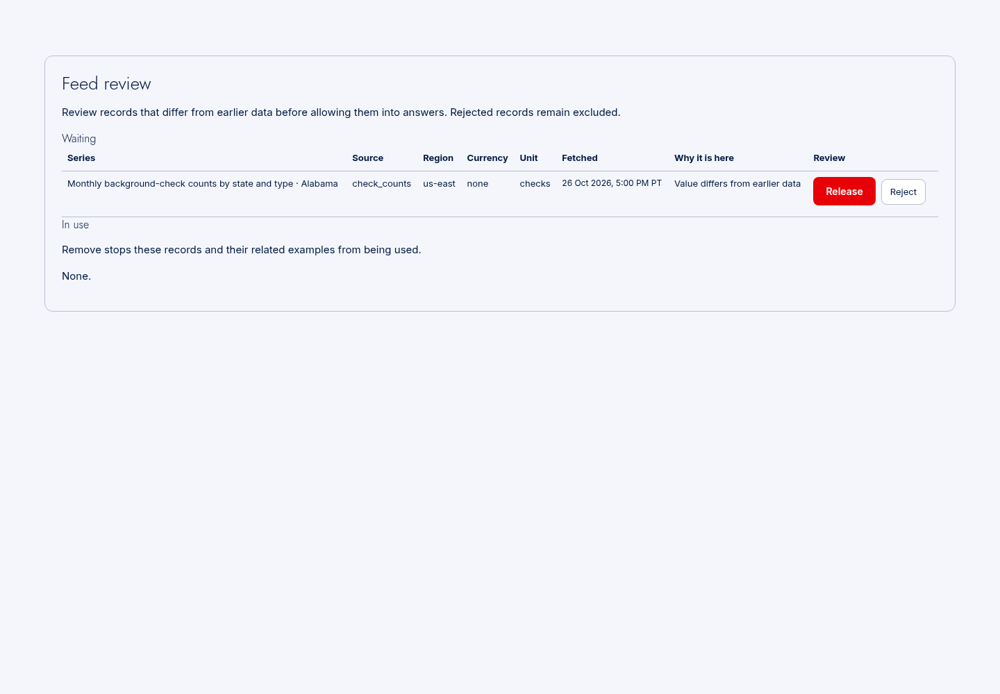
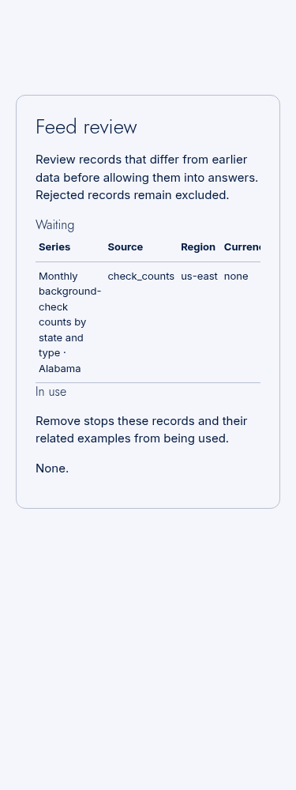
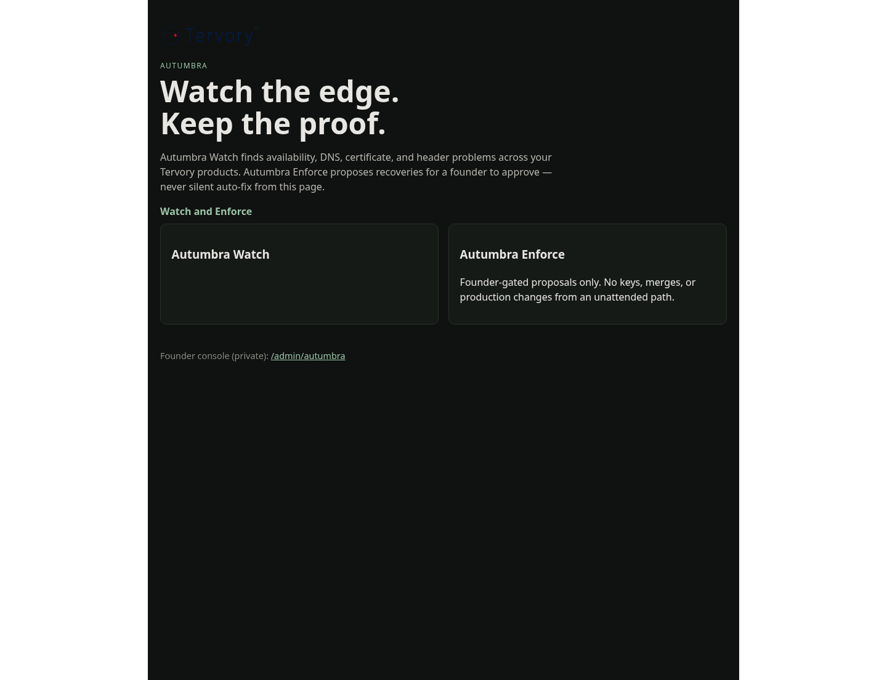
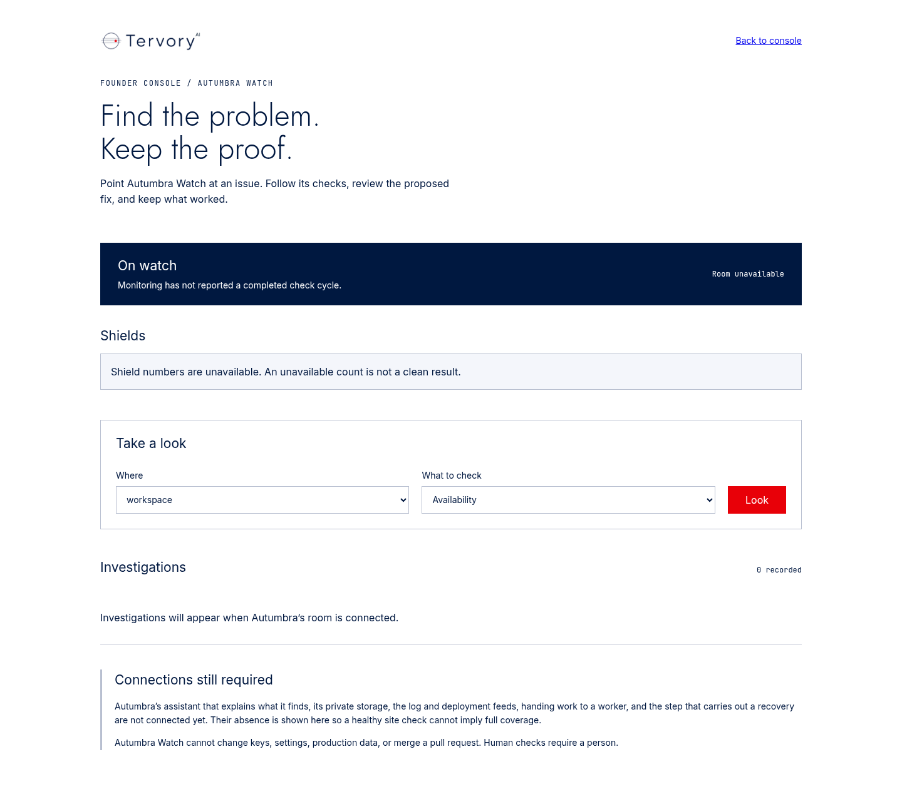
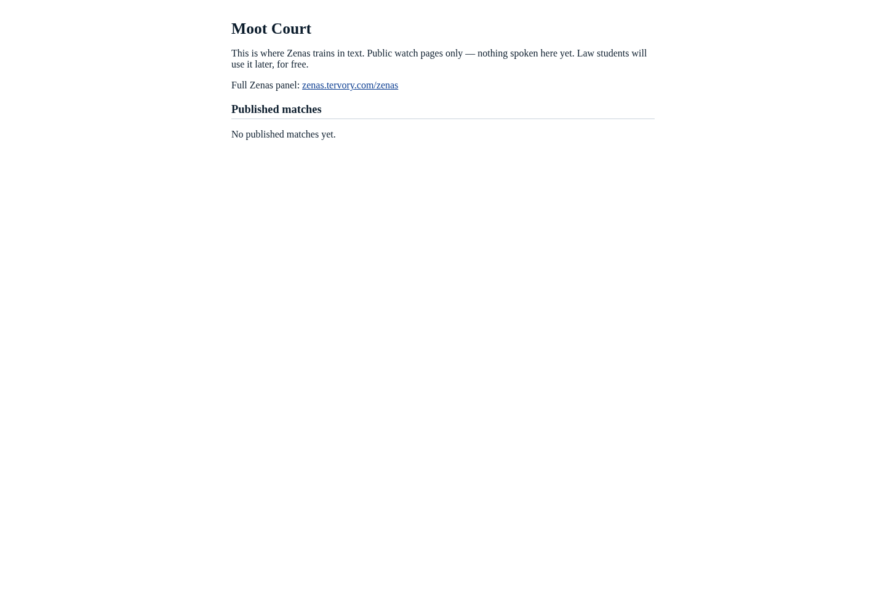
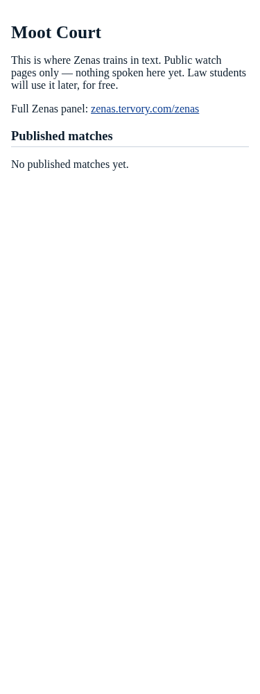

## 1. The job, step by step, as a client does it

This is the checked-in description and rule 11 proof for PR #363 on
`codex/live-page-fixtures`.

- Open the public Moot index. It lists published room records through Tank, or
  its existing “No published matches yet” state. An unpublished, missing or
  test-only match never becomes a public watch page.
- Open public Autumbra. Sample incident counts and threats are absent. The
  **Autumbra Watch card description remains empty** for the founder’s copy.
- Open the founder’s Autumbra console. Real room data is used when available;
  failed/incomplete replies show the existing unavailable states.
- Open Market Lab’s founder-only Feed review. A batch shows its catalogue series
  name and state, rather than an internal identifier. An orphan or unknown-source
  batch is skipped with its batch ID and safe reason logged; valid rows still show.

## 2. What changed

The original branch removes production fixture fallbacks from Moot and Autumbra,
adds the published-match room read/Tank proxy, and supplies readable Feed review
labels. The review follow-up changes only Market Lab’s per-row label handling,
regression tests and this evidence bundle. No new Autumbra copy was written.

**Decisions I made**

- Validate a joined row’s reference and engine before catalogue lookup. Missing
  metadata, unknown sources and unavailable engines invalidate only that row.
- Catch safe label-validation errors inside the row loop. Database/query failures
  still return the existing 503; skipped records remain stored and unmodified.
- Log the batch ID and a fixed reason, never the raw row, reference or credentials.
- Keep the existing empty Watch card and assert it in both rendered-output and
  browser checks. The founder supplies its eventual description.
- Supply local proof with the real Tank, actual Market Lab room and Postgres.
  A temporary Next wrapper supplies a local founder identity only; production
  authentication stays unchanged. No signed-in live proof is claimed.
- Use Git to read the PR head and push this branch. Do not call the GitHub API,
  change the PR’s state or request CI reruns.

Changed source/test files and their first relevant lines, relative to the original
branch base (evidence images and log files are linked below):

| File and line |
| --- |
| [agents/market_lab/app.py:206](../../agents/market_lab/app.py#L206) |
| [agents/zenas/app.py:1091](../../agents/zenas/app.py#L1091) |
| [agents/zenas/core/moot/published.py:1](../../agents/zenas/core/moot/published.py#L1) |
| [tank/main.py:3162](../../tank/main.py#L3162) |
| [tests/autumbra_watch_fixtures.test.ts:8](../../tests/autumbra_watch_fixtures.test.ts#L8) |
| [tests/batch_guard_view.test.ts:30](../../tests/batch_guard_view.test.ts#L30) |
| [tests/live_page_fixtures/PR.md:1](../../tests/live_page_fixtures/PR.md#L1) |
| [tests/live_page_fixtures/run.py:1](../../tests/live_page_fixtures/run.py#L1) |
| [tests/live_page_fixtures/server.py:1](../../tests/live_page_fixtures/server.py#L1) |
| [tests/live_page_sources.test.cjs:1](../../tests/live_page_sources.test.cjs#L1) |
| [tests/moot-watch-fixtures.ts:1](../../tests/moot-watch-fixtures.ts#L1) |
| [tests/test_live_page_sources.py:1](../../tests/test_live_page_sources.py#L1) |
| [tests/test_moot_1a.py:201](../../tests/test_moot_1a.py#L201) |
| [tests/test_zenas_proxy.py:392](../../tests/test_zenas_proxy.py#L392) |
| [workspace/app/admin/autumbra/page.tsx:9](../../workspace/app/admin/autumbra/page.tsx#L9) |
| [workspace/app/admin/autumbra/panel.tsx:109](../../workspace/app/admin/autumbra/panel.tsx#L109) |
| [workspace/app/admin/autumbra/shields-data.ts:3](../../workspace/app/admin/autumbra/shields-data.ts#L3) |
| [workspace/app/admin/autumbra/shields-fixtures.ts:1](../../workspace/app/admin/autumbra/shields-fixtures.ts#L1) |
| [workspace/app/admin/autumbra/watch-data.ts:1](../../workspace/app/admin/autumbra/watch-data.ts#L1) |
| [workspace/app/admin/autumbra/watch-fixtures.ts:2](../../workspace/app/admin/autumbra/watch-fixtures.ts#L2) |
| [workspace/app/autumbra/page.tsx:2](../../workspace/app/autumbra/page.tsx#L2) |
| [workspace/app/market-lab/quarantine-view.tsx:27](../../workspace/app/market-lab/quarantine-view.tsx#L27) |
| [workspace/app/market-lab/quarantine.ts:5](../../workspace/app/market-lab/quarantine.ts#L5) |
| [workspace/app/moot/WatchPanel.tsx:78](../../workspace/app/moot/WatchPanel.tsx#L78) |
| [workspace/app/moot/[match]/page.tsx:9](../../workspace/app/moot/[match]/page.tsx#L9) |
| [workspace/app/moot/page.tsx:6](../../workspace/app/moot/page.tsx#L6) |
| `workspace/app/moot/store.test.ts` removed; replaced by offline source tests in `tests/` |
| [workspace/app/moot/store.ts:1](../../workspace/app/moot/store.ts#L1) |
| [workspace/lib/tank.ts:1008](../../workspace/lib/tank.ts#L1008) |

## 3. How it was tested

Commands below run from the repository root with the pinned Python dependencies
installed in a Python 3.12 environment and Workspace dependencies installed.
The cloud reused its existing dependency environment; no founder computer or
credentials were used.

```sh
python3 -m pip install -r tank/requirements.txt -r tank/requirements-dev.txt -r agents/market_lab/feeds/requirements.txt
cd workspace
npm install --no-package-lock --no-audit --no-fund
cd ..
ruff check tank tests --select E9,F --per-file-ignores 'tank/skills/base.socials/1.0.0/run.py:F401'
PYTHONPATH=tank python3 -m pytest -q tests/test_live_page_sources.py
PYTHONPATH=tank python3 -m pytest -q tests/test_market_lab*.py tests/test_market_quarantine_proxy.py
PYTHONPATH=tank python3 -m pytest -q tests/test_moot_1a.py tests/test_zenas_proxy.py
node --test tests/live_page_sources.test.cjs tests/batch_guard_view.test.ts tests/autumbra_watch_fixtures.test.ts
(cd workspace && NEXT_TELEMETRY_DISABLED=1 npm run build)
```

Observed local results:

| Check | Result | Full output |
| --- | --- | --- |
| CI lint command | All checks passed | [lint.txt](lint.txt) |
| Offline route regressions | 8 passed | [python-tests.txt](python-tests.txt) |
| Market Lab and quarantine proxy | 136 passed, 3 skipped | [market-tests.txt](market-tests.txt) |
| Moot and Zenas proxy | 47 passed | [moot-tests.txt](moot-tests.txt) |
| Node route/empty-state checks | 14 passed | [node-tests.txt](node-tests.txt) |
| Next production build | Compiled; types passed; 37/37 static pages; completed | [next-build.txt](next-build.txt) |

The three default-suite skips need a local database. The separate proof below
starts the real Tank against a new local Postgres database, runs the real refresh
job with saved provider inputs, then exercises the quarantine route through Tank.
Five existing FastAPI lifespan deprecation warnings occurred in the product test
commands; they are retained in the logs. CI status was not queried.

For the browser/real-Tank proof, install Chromium at `/usr/bin/chromium` and use a
disposable loopback Postgres database ending in `_test`. The script refuses any
other target. For the database used by this run:

```sh
DATABASE_URL=postgresql://postgres@127.0.0.1:54331/live_page_review_final_test \
  python3 tests/live_page_fixtures/run.py /tmp/live-page-proof
```

The proof seeds one valid batch, one orphan and one unknown-source batch. It
asserts that the real Tank route returns only the valid row, an unauthorised user
is refused, and the room logs both skipped IDs and their respective reasons.
No part of Tank is mocked. The room scheduler is disabled so no public feed is
contacted; the actual refresh function runs with stored provider input. Next uses
the production route components and transport. Its temporary wrapper supplies a
local founder identity, not a Clerk session. Autumbra and Zenas rooms are absent,
so their captured pages prove existing unavailable/empty states only. Populated
Moot records are covered by the offline route/component tests, not these captures.

Browser checks, performed at 1440px and 375px:

1. `/market-lab`: Feed review has one row with the Alabama series label, no raw
   platform identifier and no list-wide error. No review action is submitted.
2. `/autumbra`: the Watch card contains its heading only; no sample incident board.
3. `/admin/autumbra`: Room unavailable and Shield numbers are unavailable appear;
   no sample receipts or fabricated incident counts replace the missing room.
4. `/moot`: No published matches yet appears with no sample match links.
5. `/moot/fixture-published`: returns 404.
6. All captured pages have no `Fixture`, `[TEST]`, placeholder CVE, internal
   threat-payload label or raw platform identifier in visible text. No browser
   exceptions or external browser requests occurred.

## 4. Proof

All captions below are **local, fixture page**. They are not live deployment or
Clerk sign-in evidence. The original components render the actual local route
responses; no production file is replaced by fixture HTML.



local, fixture page — Valid Feed review row remains after invalid rows are skipped, 1440px.



local, fixture page — Valid Feed review row remains after invalid rows are skipped, 375px.



local, fixture page — Watch description left empty, 1440px.


local, fixture page — Watch description left empty, 375px.



local, fixture page — Founder console with room unavailable, 1440px.


local, fixture page — Founder console with room unavailable, 375px.



local, fixture page — Moot with no published matches, 1440px.



local, fixture page — Moot with no published matches, 375px.

Real startup log: [tank-startup.txt](tank-startup.txt). Next server requests:
[next-server.txt](next-server.txt). The real Tank starts via `python3 -m uvicorn main:app` from `tank/`, with its full lifespan and local Postgres. The unused
Redis cache and Base reference service are absent from this isolated proof;
their unavailable messages remain in the log.

Job and browser result ([job.json](job.json)):

```json
{
  "label": "local, fixture page",
  "screenshots": [
    "quarantine-1440.png",
    "autumbra-1440.png",
    "autumbra-unavailable-1440.png",
    "moot-empty-1440.png",
    "quarantine-375.png",
    "autumbra-375.png",
    "autumbra-unavailable-375.png",
    "moot-empty-375.png"
  ],
  "browser_errors": [],
  "external_requests": [],
  "real_tank": "passed",
  "good_batches": 1,
  "skipped_batches": 2,
  "refresh_job": "completed with saved provider inputs",
  "founder_only": "passed",
  "watch_description": "empty"
}
```

## 5. Founder must decide

The Autumbra Watch card description is intentionally empty. The founder supplies
that copy; this branch adds none.

Live browser proof remains with the founder/Claude after deployment; no test
access exists for this builder. Open Market Lab → Feed review as the founder and
check that valid rows still show when another stored batch has missing series
metadata. Match skipped batch IDs and reasons to the room log; the rows themselves
must remain stored. Open public Autumbra and confirm the blank Watch description,
then the private console and verify actual room data or the existing unavailable
state. Open `/moot` and confirm only published room matches appear; unpublished or
missing IDs must return 404. No permission or deployment is requested here.
