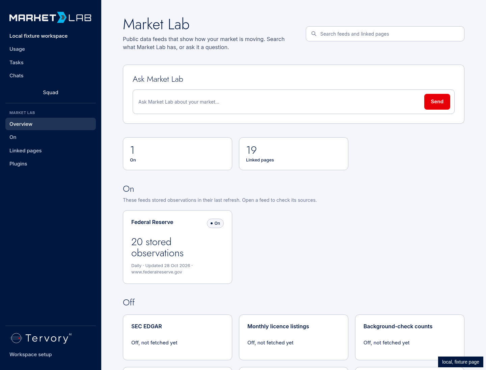
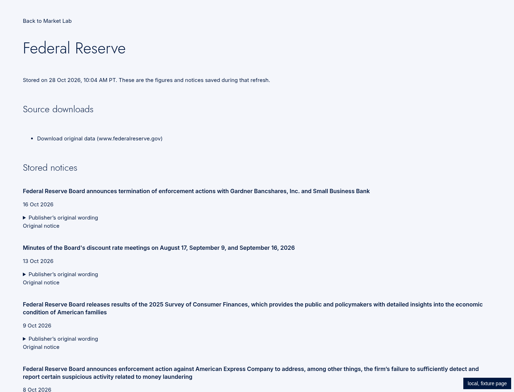

# Market Lab: tenant RSS/Atom imports and keyless sources

The existing **Plugins → Source links** form now subscribes a tenant to a public RSS or Atom feed. Adding a link queues its first import; the existing page refreshes while the worker runs, then shows saved items with their original links. Daily and weekly choices control subsequent checks. Removal stops imports and removes that tenant's saved feed evidence.

Branch: `codex/market-lab-keyless-feeds`. Started from main `a93da69`, then integrated main `241d802` in merge `573e14d` when the event publisher landed. Final browser and regression proofs ran after that merge; later commits retain the evidence and this description. Git only; Claude opens the draft PR. Founder deployment and acceptance remain outstanding.

## What changed

| File and line | Behavior |
| --- | --- |
| `agents/_chassis/chassis/public_urls.py:7`, `agents/tiger/watch.py:146` | Share Tiger's existing public-address/DNS validator, retaining Tiger's `BadWatch` interface. |
| `agents/market_lab/feeds/keyless.py:25`, `agents/market_lab/feeds/keyless.py:80` | Validate public addresses and safe citation URLs; parse RSS/Atom with pinned feedparser, preserving publisher titles, links, dates, excerpts and retrieval times. |
| `agents/market_lab/feeds/keyless.py:102`, `agents/market_lab/feeds/keyless.py:126` | Parse SearXNG results and Comtrade's public preview through the existing adapter/store interface. |
| `agents/market_lab/feeds/adapters.py:748`, `agents/market_lab/feeds/fetch.py:447` | Register the new adapters and live handlers. |
| `agents/market_lab/feeds/fetch.py:45`, `agents/market_lab/feeds/reader.py:52` | Preserve publisher XML bytes and encoding in response readers. |
| `agents/market_lab/feeds/live.py:175`, `agents/market_lab/feeds/collect.py:46` | Limit new feed downloads to 2 MiB, validate each public-feed redirect and retain existing pacing/access-boundary stops. |
| `agents/market_lab/feeds/collect.py:89`, `tank/market_lab_routes.py:84` | Reach the fixed internal SearXNG service through the authenticated, region-checked Tank corridor, without a model call. |
| `agents/market_lab/feeds/engines/ffl/sources.py:42` | Add Comtrade and SearXNG to the existing engine feed plan and refresh schedule. Source codes and queries stay in the engine. |
| `agents/market_lab/schema.sql:8`, `agents/market_lab/core/feed_links.py:34` | Store tenant subscriptions and next-check times; import due links through the existing collection/ledger path. |
| `agents/market_lab/core/feed_links.py:88`, `agents/market_lab/core/feed_links.py:114` | Queue first imports, register daily/weekly checks and serialize removal with in-flight imports. All SQL scopes its tenant. |
| `agents/market_lab/app.py:66`, `agents/market_lab/app.py:191`, `agents/market_lab/app.py:333` | Register the subscription worker and private room routes. |
| `agents/market_lab/core/jobs.py:51`, `agents/market_lab/core/evidence.py:157`, `agents/market_lab/core/http.py:69` | Reuse collection, batch checks, immutable source documents, tenant-filtered answers and page refresh status. |
| `tank/vault_routes.py:118`, `tank/vault_routes.py:160`, `tank/vault_routes.py:250` | Connect existing Source links list/add/remove actions to the owning room. |
| `workspace/lib/tank.ts:1079`, `workspace/app/market-lab/load.ts:31`, `workspace/app/market-lab/model.ts:159` | Fill existing cards from actual tenant source metadata and stored observations. |
| `agents/market_lab/feeds/presentation.py:98`, `workspace/app/market-lab/source-view.tsx:51` | Keep validated HTTP and HTTPS item links clickable. |
| `workspace/app/market-lab/view.tsx:505` | Remove the obsolete sentence saying saved links are excluded from answers. No new page wording or controls. |
| `agents/market_lab/feeds/requirements.txt:8` | Pin `feedparser==6.0.14`, an existing open-source RSS/Atom parser. |
| `.env.example:142`, `agents/market_lab/docker-compose.yml:31`, `agents/market_lab/feeds/keys.py:40` | Wire the name `USPTO_API_KEY`, with no value; USPTO remains disabled. |
| `agents/market_lab/feeds/runner.py:84` | Skip disabled entries without recording a failed fetch that was never attempted. |

RSS/Atom and search items use existing `feed_documents`/`feed_checks` evidence storage. Trade observations additionally use existing tenant series/points and batch checks. Every item keeps its source URL and retrieval time. Normal client reads exclude fixture records. Public query parameters needed to reproduce Comtrade requests are preserved; credential-bearing URLs are rejected.

Main #412 now supplies `marketlab.signal.scored` in `agents/market_lab/core/jobs.py:214`. The existing scoring job publishes through Tank after saving each computed score. Raw news/search items remain observations until a scoring job computes a score. Its existing publisher test was run with real disposable Redis and passed.

## Source status

| Source | Result |
| --- | --- |
| RSS/Atom | Tenant URL list through the existing form; immediate import, then daily/weekly. Same public-IP/DNS validator as Tiger, including redirect validation. |
| UN Comtrade | Keyless `/public/v1/preview/C/A/HS`; one request for the engine's configured codes and previous calendar year, at most 500 rows. Preview coverage is incomplete by definition. The recorded real response contains 8 rows. |
| SearXNG | Existing internal `http://searxng:8080/search`, reached through Tank. Stores result titles, supplied snippets, source links and retrieval times. The saved response is explicitly a stub; no deployed search result is claimed. |
| USPTO / PatentsView | **Off.** The current ODP patent endpoint returns 401 without a key; the official PatentsView page directs users to ODP. No permitted keyless bulk-download contract was verified. `USPTO_API_KEY` is wired by name; no authenticated fetcher or key value was created. |
| Census, FRED, EIA, NOAA climate, LegiScan | Existing key gates retained; empty settings prevent requests. Existing FRED storage restrictions remain in force. |
| MarineTraffic, Freightos, LME | Skipped: paid access. |
| Reddit | Skipped: requires app sign-in. |

Access evidence: [USPTO's unauthenticated response](../market_lab_feeds/evidence/uspto-access.json), [official PatentsView page](https://www.uspto.gov/ip-policy/economic-research/patentsview), [Comtrade preview documentation](https://uncomtrade.org/docs/what-is-data-preview/), [official Comtrade client](https://github.com/uncomtrade/comtradeapicall/blob/0848a3f/src/comtradeapicall/PreviewGet.py). Existing two-second per-host pacing is retained. A 401/403/429 or detected access boundary stops that host for the collection run without retrying around it.

## Tests changed

New saved-response tests are in `test_keyless.py:1`; tenant isolation is at `test_keyless.py:190`, and the fixed Tank/SearXNG corridor test at `test_keyless.py:226`. `test_subscriptions.py:23` proves daily/weekly timing, ownership, removal and queued-work safety on local Postgres. [Recording provenance](evidence/recordings.json) distinguishes actual publisher responses from the search stub.

- `tests/test_feeds_backfill.py:53`: exact totals include eight trade observations and two search results; disabled USPTO makes no fetch attempt; re-import still adds nothing.
- `tests/test_market_lab_page.py:57`: retain the static catalogue contract and explicitly account for new API-backed source metadata.
- `tests/test_market_lab_review.py:273`: permit reproducible, credential-free Comtrade queries while retaining query stripping checks for keyed feeds.
- `tests/test_market_lab_postgres.py:35` and `tests/test_market_lab_real_tank.py:46`: saved-feed count changes from 16 to 18.
- `workspace/app/market-lab/model.test.ts:91`: tenant metadata renders through existing cards only when that tenant has a stored document.

## Exact local verification

Commands ran from `/workspace/tervory-tank`, except TypeScript, which ran from its `workspace/` subdirectory. These paths identify the installed local tools; a fresh clone can use its activated equivalent after installing `tank/requirements-dev.txt` and Workspace dependencies.

```sh
/workspace/.tervory-cloud/venv/bin/ruff check tank tests --select E9,F --per-file-ignores 'tank/skills/base.socials/1.0.0/run.py:F401'
```

Result: **All checks passed**. The new parser and subscription modules also passed `--select E9,F`.

```sh
PATH=/workspace/.tervory-cloud/node-v22.23.4-linux-x64/bin:$PATH PYTHONPATH=tank /workspace/.tervory-cloud/venv/bin/python -m pytest -q tests/test_feeds_*.py tests/test_market_lab*.py tests/test_vault_contract.py tests/market_lab_keyless_feeds tests/market_lab_feeds --tb=short
```

Result: **235 passed, 5 skipped, 1 failed**. [Output](evidence/regressions.txt). The failure is `test_industry_words_stay_in_the_engine` at `tests/test_feeds_boundaries.py:121`: its repository-wide test-file scan reports five existing files in other products' proofs. It fails on untouched main `241d802` with exactly the same five paths: [main output](evidence/main-boundary.txt), [identical path comparison](evidence/baseline-comparison.json). It also failed identically on starting main `a93da69`. The skipped cases require separately selected local test services.

```sh
PYTHONPATH=tank /workspace/.tervory-cloud/venv/bin/python -m pytest -q tests/test_secrets.py tests/test_tank_boots.py tests/test_tank_one_door.py tests/test_tiger.py
```

Result: **53 passed, 1 skipped**. [Output](evidence/ci-gates.txt). Actual Tank startup/database operation are separately exercised by the browser proof below.

```sh
DATABASE_URL=postgresql://postgres@127.0.0.1:32772/market_keyless_test PYTHONPATH=tank /workspace/.tervory-cloud/venv/bin/python -m pytest -q tests/market_lab_keyless_feeds/test_subscriptions.py tests/test_market_lab_postgres.py
PYTHONPATH=tank /workspace/.tervory-cloud/venv/bin/python -m pytest -q tests/tenant_bus/test_producers.py::test_marketlab_emits_once_per_saved_scored_signal
```

Results: **2 passed** on disposable Postgres; **1 passed** with disposable Redis. [Postgres output](evidence/postgres.txt), [publisher output](evidence/event-publisher.txt).

```sh
PATH=/workspace/.tervory-cloud/node-v22.23.4-linux-x64/bin:$PATH node node_modules/typescript/bin/tsc --noEmit --incremental false
/workspace/market-docs-security/venv/bin/pip-audit -r agents/market_lab/feeds/requirements.txt --format json --output /workspace/market-lab-keyless/dependency-audit.json
git diff --check origin/main -- . ':!tests/market_lab_keyless_feeds/fixtures/feed.xml'
```

Results: TypeScript **exit 0**; audit **no known vulnerabilities**; code diff check **exit 0**. [Dependency report](evidence/dependency-audit.json). The raw RSS recording is excluded from whitespace checking because it preserves the publisher's BOM, CRLF and trailing whitespace.

## Real job and browser proof

The disposable `postgres:16` database used tmpfs, trust authentication and a loopback-only published port. No production data was read or changed. Reproduction uses an equivalent local container and its ephemeral port:

```sh
env -u DOCKER_HOST -u DOCKER_CONTEXT -u DOCKER_TLS -u DOCKER_TLS_VERIFY -u DOCKER_CERT_PATH docker --host=unix:///var/run/docker.sock run --detach --rm --name market-keyless-test --tmpfs /var/lib/postgresql/data:size=512m -e POSTGRES_HOST_AUTH_METHOD=trust -e POSTGRES_DB=market_keyless_test -p 127.0.0.1::5432 postgres:16
DATABASE_URL=postgresql://postgres@127.0.0.1:32772/market_keyless_test PATH=/workspace/.tervory-cloud/node-v22.23.4-linux-x64/bin:$PATH PYTHONPATH=tank /workspace/.tervory-cloud/venv/bin/python tests/market_lab_keyless_feeds/keyless_proof.py --output /workspace/market-lab-keyless/real-stack-final --browser
```

The harness starts the real Tank app, room app/scheduler/worker, Postgres and Chromium. Publisher HTTP responses are replayed from saved responses. The temporary Next wrapper uses production components, loader, server actions and Tank client, with a local identity and CI's dummy Clerk publishable key. Production authentication files are unchanged. It clicks **Plugins → Source links → Add link**, waits for the real job, opens the stored source, checks the other tenant cannot read/delete it, then removes it as its owner. SQL assertions verify job completion, daily timing and zero model-ledger rows.

Actual [result.json](evidence/result.json):

```json
{
  "proof": "local, fixture page",
  "tank": "real app startup and HTTP routes",
  "worker": "real room scheduler and job worker",
  "rss_items": 20,
  "source_links": 20,
  "retrieval_times": 20,
  "tenant_isolation": "passed",
  "private_url_rejected": true,
  "delete_stops_subscription_and_removes_evidence": true,
  "model_calls": 0,
  "browser_add_link": true
}
```

Public recordings: RSS **20** items, Atom **18** items, Comtrade **8** rows. SearXNG's offline stub contains **2** recorded publisher links. These do not claim a live founder-session result.





## Founder acceptance and remaining decisions

- After deployment, add a public RSS/Atom URL through the existing Source links form and confirm its items appear with original links. The screenshots are labelled **local, fixture page**; the deployed-browser acceptance check remains outstanding.
- USPTO stays disabled. Its setting name is present for a later verified API/bulk-data integration; no value or sign-in was requested.
- Paid sources and Reddit remain skipped as instructed.
- The unrelated industry-word scan failure needs resolution on main; identical baseline evidence is attached above.
