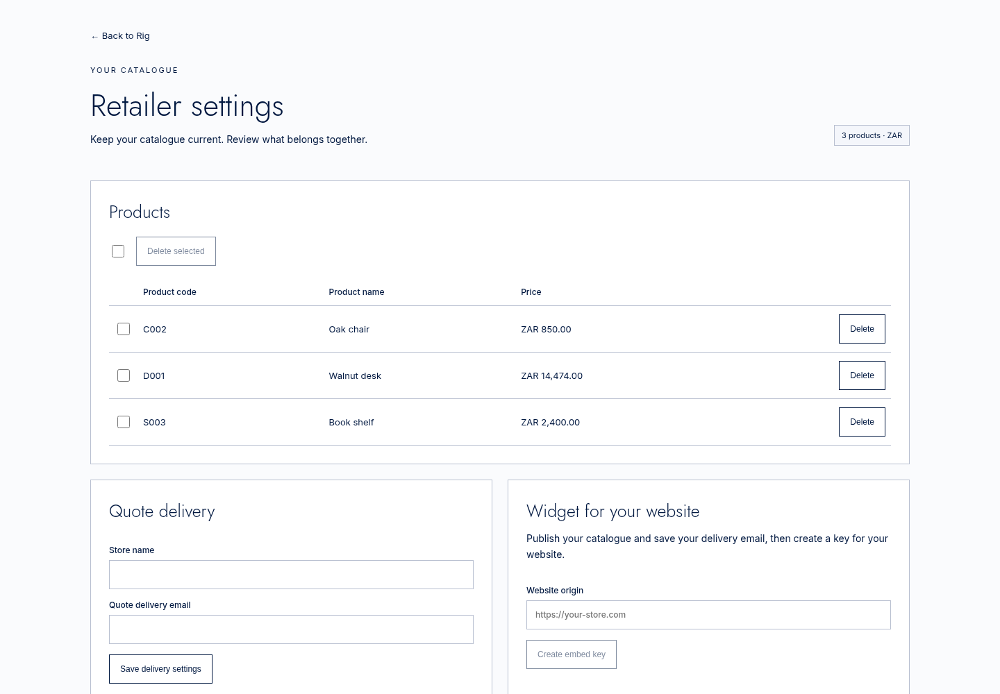
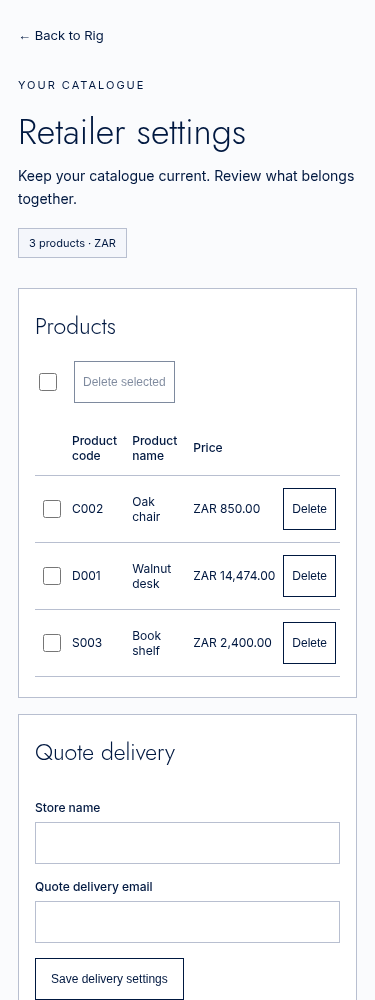
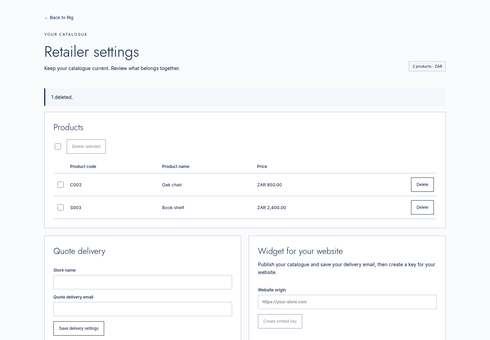
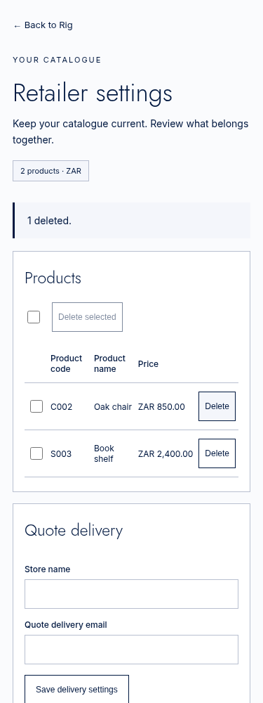
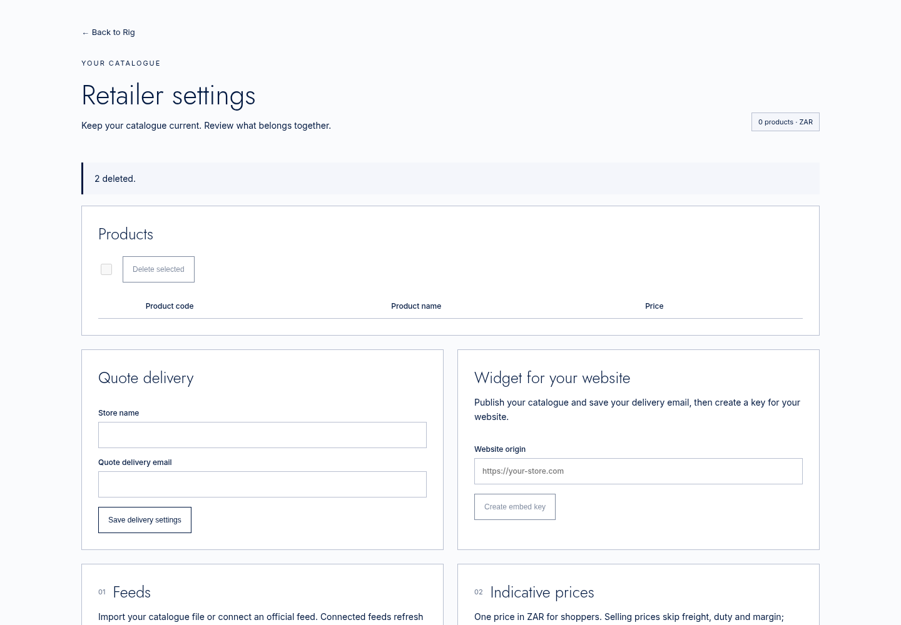
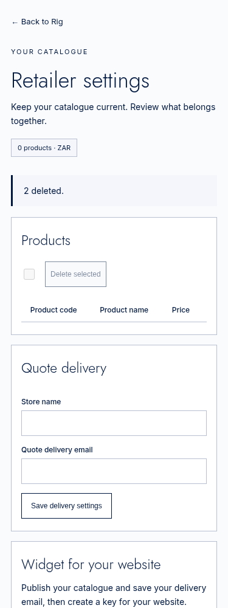

# Rig: delete products from the active retailer catalogue

A retailer can now remove products from Products in `/rig/admin`. The product disappears from the list and Rig search, its private cost and fits are removed, its families are saved without it, and quote history stays unchanged. Refreshes keep it removed; a successful manual import containing its product code restores it.

Branch: `codex/rig-delete-products`, based on `origin/main` at `4e74b42`. Git pushes only. Claude opens the one draft PR. No GitHub API, production changes, merge, new setting or paid service.

## What changed (file and line)

| File | Change |
| --- | --- |
| [retailer.py:75](../../agents/rig/rigbox/retailer.py#L75), [91](../../agents/rig/rigbox/retailer.py#L91), [202](../../agents/rig/rigbox/retailer.py#L202) | Tenant product rows contain only code, name, selling price and currency. Validate 1–5,000 codes, deduplicate them, delete and save the receipt in one `store.atomic` transaction. Distinguish refresh from manual import. |
| [retailer_api.py:15](../../agents/rig/rigbox/retailer_api.py#L15), [64](../../agents/rig/rigbox/retailer_api.py#L64) | Add private `delete-products` operation behind the existing control authentication. |
| [store.py:242](../../agents/rig/rigbox/store.py#L242), [518](../../agents/rig/rigbox/store.py#L518), [591](../../agents/rig/rigbox/store.py#L591) | Memory and Postgres removal records, deletion, family cleanup, cache invalidation and restoration. Legacy writes share the tenant transaction lock and respect removals. |
| [service.py:785](../../agents/rig/rigbox/service.py#L785), [837](../../agents/rig/rigbox/service.py#L837) | Legacy folder/feed loaders do not count a skipped removed product as updated. |
| [schema.sql:59](../../agents/rig/schema.sql#L59) | Additive, idempotent `agent_rig.deleted_products`, keyed by tenant and product code. |
| [access.py:743](../../tank/access.py#L743), [811](../../tank/access.py#L811), [926](../../tank/access.py#L926) | Tag connected-feed refresh on the server; allow deletion through the existing Tank retailer path, including a bounded body large enough for 5,000 codes. Actor supplies tenant identity. |
| [types.ts:5](../../workspace/app/rig/admin/types.ts#L5) | Product rows, deletion count and operation types. |
| [actions.ts:21](../../workspace/app/rig/admin/actions.ts#L21) | Deletion uses the existing founder-or-org-admin check and active tenant, returns the actual deleted count and reloads the real panel. |
| [api/route.ts:5](../../workspace/app/rig/admin/api/route.ts#L5) | Permit the operation through the existing same-origin, bounded Workspace route. |
| [tank.ts:968](../../workspace/lib/tank.ts#L968) | Add the operation to the server-side Rig helper allow-list. |
| [products.tsx:6](../../workspace/app/rig/admin/products.tsx#L6) | Products table, row and select-all checkboxes, Delete/Delete selected, exact singular/plural confirmation. Stored data only. |
| [retailer-admin.tsx:31](../../workspace/app/rig/admin/retailer-admin.tsx#L31), [128](../../workspace/app/rig/admin/retailer-admin.tsx#L128), [181](../../workspace/app/rig/admin/retailer-admin.tsx#L181) | Wire deletion and refreshed rows into the page; show the actual success count and count-only deletion receipts in Import history. |
| [retailer-admin.css:3](../../workspace/app/rig/admin/retailer-admin.css#L3) | Product-table layout using existing page colours and typography. |
| [test_rig_delete_products.py:1](../test_rig_delete_products.py#L1) | Both stores, one/many deletions, tenant isolation, costs/fits/families, unchanged quotes, cache/search invalidation, refresh/manual restore, failed-transaction rollback, limits, founder routing and dependent 3D jobs. |
| [actions.test.cjs:1](actions.test.cjs#L1) | Execute real Workspace route, actions, founder helper and Tank helper. Founder succeeds without org-admin role; org admin succeeds; ordinary member and another origin fail; active tenant wins. |
| [server.py:1](server.py#L1), [browser.cjs:1](browser.cjs#L1) | Reproducible local proof with real Tank, real Rig routes and disposable Postgres, plus browser assertions and screenshots. |
| [PR.md:1](PR.md#L1), [job.json:1](job.json#L1), [startup.txt:1](startup.txt#L1), [python-tests.txt:1](python-tests.txt#L1), [lint.txt:1](lint.txt#L1), [actions.txt:1](actions.txt#L1), [existing-actions.txt:1](existing-actions.txt#L1), [next-build.txt:1](next-build.txt#L1), [broad-suite-collection.txt:1](broad-suite-collection.txt#L1) | Description, exact commands/results, startup log, job output and the broader-run limitation. Six PNG screenshots are linked below. |

## Decisions I made

- The founder keeps the existing allow-list bypass in both Workspace and Tank. The proof uses an account in `TERVORY_ADMIN_USER_IDS` with an ordinary `org:member` role and no squad grant. It successfully deletes in its active tenant.
- Only the founder-approved words were added to the product controls and deletion receipt. Existing surrounding page text and existing failure messages are reused. Native browser confirmation supplies its own system buttons; no custom dialog copy was invented.
- Connected-feed refresh, including “Refresh now”, keeps removals. Only successful manual imports restore their included products. A failed import rolls restoration back.
- Each request of at most 5,000 codes is one transaction. Select-all on a larger catalogue sends sequential batches of at most 5,000, refreshes after each, and reports the total actual deletions. A failure stops subsequent batches; already completed batches have their own receipts.
- The existing receipt shape is unchanged: provider `delete-products`, `updated` is the deletion count, `added` and `rejected` are zero. The page displays “Products” and “{n} deleted.” No code, cost, contact detail or deleted product payload enters the receipt.
- Clear only the affected tenant’s graph/setup answers and saved search recall, since another product’s result can contain the removed product. Quote requests and their historical payloads are untouched.
- A fit to a family remains while that family has products. Removing its final member also removes fits targeting the now-empty family. Refresh does not recreate those fits.
- `rig_3d_jobs` has a foreign key to the product. Its dependent rows must be deleted in the same transaction for product deletion to work. Other products’ and tenants’ jobs remain. No R2 object removal or forge call was added.

## Commands run and results

All work ran in the cloud. Python 3.12; FastAPI 0.162.0, Starlette 1.10.0, Uvicorn 0.54.0, asyncpg 0.30.0, httpx 0.28.1, Pydantic 2.10.6, pytest 9.1.1, pytest-asyncio 1.4.1, Ruff 0.17.2. Existing cloud dependencies were reused; no product dependency was changed.

```sh
/workspace/market-lab-warnings/.venv/bin/ruff check tank tests --select E9,F \
  --per-file-ignores 'tank/skills/base.socials/1.0.0/run.py:F401'
# All checks passed!

RIG_TEST_DATABASE_URL=postgresql://postgres@127.0.0.1:54332/rig_delete_test \
PYTHONPATH=tank /workspace/market-lab-warnings/.venv/bin/python -m pytest -q \
  tests/test_rig_delete_products.py tests/test_rig_feeds_retailer.py \
  tests/test_rig_feeds_catalogues.py tests/test_rig_postgres.py \
  tests/test_rig_recall.py tests/test_rig_feeds_review.py \
  tests/test_rig_feeds_workspace.py tests/test_rig.py tests/test_rig_feeds.py \
  tests/test_rig_admin.py tests/test_rig_recall_window.py tests/test_rig_quotes.py \
  tests/test_rig_quotes_postgres.py tests/test_rig_store_job.py
# 169 passed in 4.94s. Includes local Postgres, schema reapplication and rollback.

node tests/rig_delete_products/actions.test.cjs
# PASS: real Workspace route/actions/Tank helper; founder, org admin,
# member denial, origin and active tenant.
node tests/rig_feeds_admin_route.test.cjs
# Retailer route: session role, server tenant, origin checks and bounded uploads passed.

# From workspace/:
NEXT_TELEMETRY_DISABLED=1 npm run build
# Next 15.5.28: compiled, type checks passed, 37/37 pages generated, exit 0.

# From repo root:
RIG_ESBUILD_PATH=/workspace/.setup/rig5/browser/node_modules/esbuild \
RIG_PLAYWRIGHT_PATH=/workspace/market-lab-warnings/agents/market_lab/fixture_proof/node_modules/playwright \
READ1_CHROMIUM_EXECUTABLE=/usr/bin/chromium \
RIG_SCREENSHOT_DIR=/workspace/scratch/rig-delete-existing-browser \
node tests/rig_feeds_admin_browser.mjs
# Retailer admin: 375px/1440px screenshots, no overflow, refresh,
# approval, template and private-rule form checks passed.

RIG_DELETE_PROOF_DATABASE_URL=postgresql://postgres@127.0.0.1:54332/rig_delete_final_test \
RIG_ESBUILD_PATH=/workspace/.setup/rig5/browser/node_modules/esbuild \
RIG_PLAYWRIGHT_PATH=/workspace/market-lab-warnings/agents/market_lab/fixture_proof/node_modules/playwright \
READ1_CHROMIUM_EXECUTABLE=/usr/bin/chromium \
/workspace/market-lab-warnings/.venv/bin/python tests/rig_delete_products/server.py \
  /workspace/scratch/rig-delete-final-browser
# Real Tank panel: 200 ok
# real_tank: passed; founder_without_org_admin: passed;
# second_tenant_products: 3; browser_errors: []; external_requests: [].
```

The broader attempted `PYTHONPATH=tank .../python -m pytest -q tests/test_rig*.py` stopped during collection: this environment lacks `numpy`, `trimesh` and `huggingface_hub` for unrelated forge tests. [Full output](broad-suite-collection.txt). It is not claimed as passing. The 169-test scoped run above passed without skips. No CI result was fetched, rerun or claimed.

### Reproduce in a fresh clone

Use Python 3.12 and Node 22, install `tank/requirements.txt` and `tank/requirements-dev.txt` into a local virtual environment, and run `npm ci --no-audit --no-fund` inside `workspace/`. For the screenshot harness, install the exact versions used here outside the repo:

```sh
npm install --prefix /tmp/rig-delete-browser --no-audit --no-fund esbuild@0.28.2 playwright@1.55.0
/tmp/rig-delete-browser/node_modules/.bin/playwright install chromium
```

Set `RIG_ESBUILD_PATH=/tmp/rig-delete-browser/node_modules/esbuild` and `RIG_PLAYWRIGHT_PATH=/tmp/rig-delete-browser/node_modules/playwright`. Omit `READ1_CHROMIUM_EXECUTABLE` to use Playwright's installed Chromium. Replace the cloud virtual-environment path above with your environment's Python/Ruff.

The local database was started with this command. It has no password, binds only to loopback, and stores only disposable fixture data:

```sh
env -u DOCKER_HOST -u DOCKER_CONTEXT -u DOCKER_TLS -u DOCKER_TLS_VERIFY -u DOCKER_CERT_PATH \
  docker --host=unix:///var/run/docker.sock run --rm --name rig-delete-postgres \
  -e POSTGRES_HOST_AUTH_METHOD=trust -e POSTGRES_DB=rig_delete_test \
  -p 127.0.0.1:54332:5432 --tmpfs /var/lib/postgresql/data -d \
  postgres@sha256:9e2cf6287f25c3151f4c9421ccce2b17f3e60061c111a29165e0d2cdd9ff0a97

env -u DOCKER_HOST -u DOCKER_CONTEXT -u DOCKER_TLS -u DOCKER_TLS_VERIFY -u DOCKER_CERT_PATH \
  docker --host=unix:///var/run/docker.sock exec rig-delete-postgres \
  createdb -U postgres rig_delete_final_test
```

The browser proof requires a fresh loopback database ending in `_test`. It imports three fixture products for each of two tenants through the actual retailer importer, then starts Uvicorn with the real `tank/main.py` app and the real Rig retailer/widget route implementations backed by Postgres. It resolves only the local `agent-rig` corridor to loopback. No Tank function, route, auth check, HTTP client or database is replaced. Ports 8003 and 8054 must be free.

The browser renders the production `RetailerAdmin` and sends its actual `/rig/admin/api` requests through the real Workspace route, actions and `workspace/lib/tank.ts`. The local host supplies external Clerk identity and the Next JSON response adapter; it does not sign into Clerk or production. Public non-secret test markers authenticate only these local processes. No real credential is read or created. This is local fixture proof, not a live signed-in check.

[Startup log](startup.txt) shows `Application startup complete` for both processes. Redis and the unrelated Base reference service are not present in the harness; their startup warnings are retained. Rig's delete/search path passed. The first harness attempt could not resolve the private room name under Uvicorn's automatic uvloop selection; the final harness explicitly uses asyncio for its local DNS mapping. No production code was changed for that harness issue.

## Browser proof and screenshots

[Job output](job.json) records the actual native confirmation text, deletion receipts and widget-search responses. It proves:

1. Three stored products are listed; the widget search returns D001 before deletion.
2. Cancelling the single-product confirmation leaves all three products.
3. Confirming deletion shows “1 deleted.”, removes the row, and the widget search no longer returns D001.
4. Select-all and Delete selected confirms two products, shows “2 deleted.”, and leaves zero product rows.
5. The second tenant still has all three products and no deletion receipt.
6. Both widths have no document overflow, browser exceptions or external browser requests.








## Founder check after deploy

No new wording, service or setting needs a founder decision. Live acceptance is pending and must happen in the founder's browser.

1. Select the intended retailer, then open `/rig/admin` as the founder. Find one real product under Products and note its code.
2. Search for it in that retailer's Rig page/widget; verify it is present.
3. Press its Delete button. Verify the singular confirmation, confirm, and see “1 deleted.” The row must disappear and Import history must show the deletion count.
4. Run the same Rig search again. The product must no longer be returned. An existing quote mentioning it must remain unchanged.
5. Refresh the connected feed: the product must stay absent. A manual catalogue import containing its code must restore it.
6. For a multi-product check, select the intended rows, verify the confirmation count and use Delete selected. Only those products in the active tenant may disappear.
