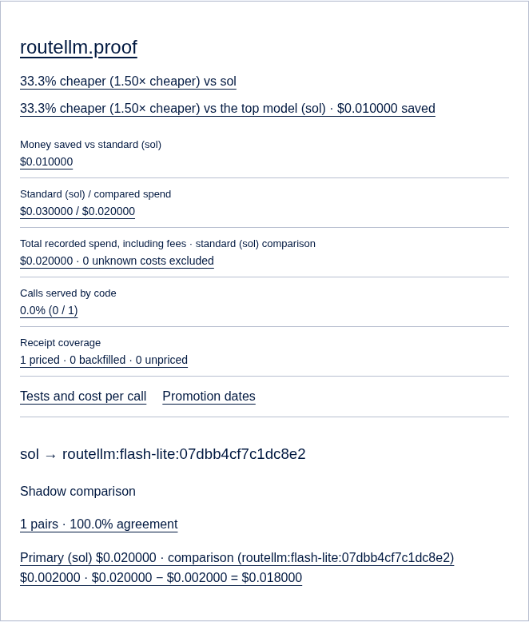
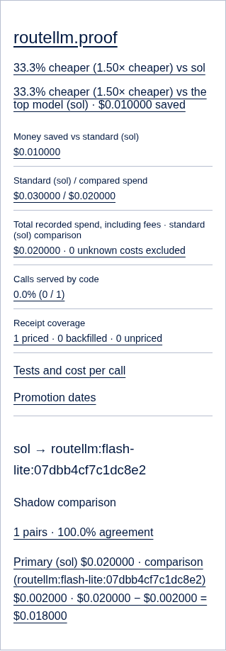

# Tank: RouteLLM CPU shadow evidence and measured sample savings

Tank still returns the policy model's answer. A founder can opt one policy row
into the local RouteLLM BERT experiment: Tank records its proposed model and
score, samples cheap selections through the existing shadow runner and judge,
and shows their measured cost difference in the existing founder proof figures.
Both new policy fields default to NULL; no existing policy is enabled.

Branch: `codex/tank-routellm`, from `origin/main` at `a99f3cb`.
Claude opens the **draft** PR. No GitHub API was used. No production setting or
row was changed. The founder's live browser check remains outstanding.

## What changed (file and line)

| File | Change |
| --- | --- |
| `.env.example:400` | Documents the optional local checkpoint path; no new key. |
| `tank/Dockerfile:1` | Installs the pinned CPU runtime and verified open checkpoint; runs as the existing unprivileged Tank user. One installation layer avoids duplicating the weights across build layers. |
| `tank/requirements-routellm.txt:1` | CPU PyTorch 2.8.0, Transformers 4.55.4 and pinned BERT runtime dependencies. |
| `tank/requirements-routellm-wheel.txt:1` | RouteLLM 0.2.0 wheel pinned by SHA-256. |
| `tank/routellm_build.py:25` | Extracts RouteLLM's original `Router`, `BERTRouter` and decorator unchanged from the verified package, retaining its licence. Downloads the immutable checkpoint and verifies the weight checksum. |
| `tank/routellm_shadow.py:52` | Default-off configuration, founder-only policy settings, serialized CPU scoring, bounded background work, existing-budget sampling, tenant-owned evidence and existing ladder figures. |
| `tank/main.py:1297` | Schedules observation after the live receipt. The existing `_llm` and `_shadow` paths at lines 1322 and 1523 provide candidate calls and agreement; no competing runner or judge. Lines 1994 and 3796 connect ladder figures and the settings router. |
| `tank/schema.sql:1922` | Additive, idempotent policy, ledger and shadow columns. No seed enables RouteLLM. |
| `tank/graduate.py:384` | Prevents a shadow-only conditional candidate identifier being served as a model or promoted into a broken route. |
| `tank/proof.py:123` | Per-task comparisons use the primary ledger cost and the shadow ledger's measured model cost, excluding judge overhead. Unknown costs, failed calls and provider fallbacks claim no savings. |
| `workspace/app/tank/proof/view.tsx:3` | Adds only numbers/arithmetic to the existing shadow comparison figure: primary cost minus comparison cost equals potential sample saving. No new page wording. |
| `tests/test_tank_routellm.py:1` | Offline router/provider stubs with actual Tank startup, handlers and SQL; two tenants, errors, costs, founder permissions and graduation gates. |
| `tests/tank_routellm/real_job.py:1` | Launches `python -m uvicorn main:app` from `tank/` against disposable Postgres; real CPU BERT, simulated external gateway. |
| `tests/tank_routellm/browser.cjs:1` | Renders the production proof component using the stored real-Tank test report and checks the comparison and evidence link at two widths. |
| `tests/tank_routellm/PR.md:1` | This description, decisions, commands and founder check. |
| `tests/tank_routellm/evidence/focused-tests.log:1`, `lint.log:1`, `next-build.log:1`, `image-build.log:1`, `image-cpu.log:1`, `startup.log:1`, `job.json:1`, `report.json:1` | Recorded local validation and generated test receipts. All paths in this row are under `tests/tank_routellm/evidence/`. |
| `tests/tank_routellm/evidence/savings-375.png`, `savings-1440.png` | Local screenshots, not production or founder-session proof. |

## Existing paths reused

- `run_route` selects the policy model, tries the existing ladder and records the
  model that actually answered. RouteLLM is scheduled only for delivered model
  calls, after that receipt. Cache/code results and explicit model overrides are
  not routed again. Prompts containing personal identifiers are not shadowed.
- `_shadow` runs a candidate through `_llm`, uses `graduate.compare` for
  structured outputs or the existing `tank.judge` policy for text, and records
  agreement. The new path reuses this execution/scoring logic. Paid research
  costs stay on the platform; evidence retains the original tenant.
- `graduate.promote_if_proven` already defaults to 99% agreement over 200 samples
  and holds automatic promotion. The existing promotion endpoint requires a
  founder. Neither behavior is relaxed here.
- The existing `/tank/proof` comparisons and `/v1/graduation` ladder carry the
  additional figures. Actual live savings remain separate from shadow savings.

## Decisions I made

1. Use RouteLLM's BERT implementation, not a new classifier. Its package imports
   an OpenAI client for an unrelated router at import time. The build adapter
   checks the upstream source hash and copies the three original BERT definitions
   byte-for-byte into an isolated module. Unrelated embedding/router dependencies
   are not installed or imported. The image smoke test confirms OpenAI is absent.
2. Pin checkpoint `routellm/bert_gpt4_augmented` at
   `86237e3df400762178ea98379477b8296e66d5e4` (Apache-2.0). Weight SHA-256:
   `e2a92240bad1c7fb9befbf021a62fad5feb1e2a3990d53a28d160a39bb1cac7b`.
   No training/optimizer pickle or remote model code is downloaded.
3. Keep this release shadow-only. A conditional selection is identified by its
   strong/weak pair, threshold and checkpoint. Selected easy-turn samples are
   **not** evidence that the weak model can replace the strong model on every
   turn. They cannot be promoted as an unconditional model. Any ordinary weak
   model promotion still goes through the existing 99%/200-sample graduation and
   founder approval. There is no conditional live-routing activation in this PR.
4. Reuse a positive policy `shadow_rate`; otherwise sample 10% of cheap choices.
   The existing shadow budget and provider restrictions remain in force. The
   founder chooses the weak model and threshold, never code. The local proof uses
   rate 1 and threshold 1 for a deterministic sample, not a production setting.
5. Show savings only on priced samples actually executed, with negative savings
   retained. Do not extrapolate to unsampled traffic. Separate the candidate's
   actual response-cost header from judge overhead in the shadow ledger.
6. Load BERT lazily on CPU with two threads, serialize inference and cap pending
   observations at four. Failure/busy states are recorded without changing the
   live answer. The image includes about 1.1 GB of model weights plus CPU runtime
   dependencies; enabling it also needs RAM for that model.
7. The brief requires small hooks in `run_route` and the existing shadow runner;
   new behavior is otherwise in the new module. No queue, cache or skill package
   was changed. No new provider, paid service, secret or page wording was added.

## Commands actually run and results

All commands ran on the cloud machine. The names below point to this session's
Python/Node installations, not anything installed on the founder's computer.

```sh
/workspace/market-lab-warnings/.venv/bin/ruff check tank tests --select E9,F --per-file-ignores 'tank/skills/base.socials/1.0.0/run.py:F401'
# All checks passed!

POOL_SCHEMA_DATABASE_URL=postgresql://postgres@127.0.0.1:55439/routellm_test \
  /workspace/market-lab-warnings/.venv/bin/python -m pytest -q \
  tests/test_tank_routellm.py tests/test_t6_graduate.py tests/test_chat_graduation.py \
  tests/test_tank_tenant_boundaries.py tests/test_core1_proof.py \
  tests/test_secrets.py tests/test_tank_boots.py
# 78 passed, 5 existing FastAPI on_event deprecation warnings.
# Includes real uvicorn startup twice on an empty/reused database.

# From workspace/:
npm run build
# Passed: compilation, TypeScript and all 37 static pages.

# Separate CPU environment, installed with Tank and requirements-routellm.txt:
/workspace/routellm-runtime/venv/bin/python tank/routellm_build.py /workspace/routellm-runtime/model
POOL_SCHEMA_DATABASE_URL=postgresql://postgres@127.0.0.1:55439/routellm_test \
  TANK_ROUTELLM_PATH=/workspace/routellm-runtime/model \
  /workspace/routellm-runtime/venv/bin/python tests/tank_routellm/real_job.py
# Passed: actual uvicorn Tank + Postgres + actual CPU BERT; simulated gateway only.

NODE_PATH=/workspace/market-lab-warnings/agents/market_lab/fixture_proof/node_modules \
  node tests/tank_routellm/browser.cjs
# Passed: production component, comparison equation, agreement and evidence link;
# screenshots at 1440px and 375px.

# Use the managed cloud's local Docker daemon and public CA bundle:
env -u DOCKER_HOST -u DOCKER_CONTEXT -u DOCKER_TLS -u DOCKER_TLS_VERIFY -u DOCKER_CERT_PATH \
  BUILDX_CONFIG=/workspace/routellm-runtime/buildx \
  docker --host=unix:///var/run/docker.sock build \
  --secret id=proxy_ca,src=/etc/ssl/certs/ca-certificates.crt -t tank-routellm:local tank
# Passed; image sha256:547bf02f9e14461e278bef28ab5884ce6ca1a68815ecce0bf6c0f76e9093472f.

env -u DOCKER_HOST -u DOCKER_CONTEXT -u DOCKER_TLS -u DOCKER_TLS_VERIFY -u DOCKER_CERT_PATH \
  docker --host=unix:///var/run/docker.sock run --rm --network none --read-only --tmpfs /tmp \
  --name tank-routellm-cpu-proof tank-routellm:local python -c \
  'import json, sys; import routellm_shadow as r; value=r.score("What is two plus two?"); assert 0 <= value <= 1; assert "openai" not in sys.modules; print(json.dumps({"score":value,"device":str(next(r._bert.model.parameters()).device),"checkpoint":r.REVISION,"network":"none","openai_imported":False}))'
# Passed as the image's non-root user: CPU, score 0.35607945919036865,
# networking disabled, OpenAI not imported.

git diff --check
# Passed.
```

An earlier regression invocation ran before the Node dependency link existed;
its tenant-name check failed. After setup, the full invocation above passed.
The first image layout exhausted this cloud machine's VFS scratch space. Only
this task's failed build cache was removed; the single-layer installation above
then built successfully. Temporary duplicate CPU environments were removed after
proof to recover space. No CI execution is claimed; no GitHub API was queried.

For a fresh clone, install `tank/requirements.txt`, `tank/requirements-dev.txt`
and `tank/requirements-routellm.txt` in a Python 3.12 virtual environment, then
install `tank/requirements-routellm-wheel.txt` with `--no-deps --require-hashes`.
Run `routellm_build.py` to a writable local directory and set
`TANK_ROUTELLM_PATH` to it. Set `POOL_SCHEMA_DATABASE_URL` to a disposable local
Postgres database. Install Workspace dependencies with `npm ci`; the browser
script additionally requires Playwright 1.55.0 and Chromium (`CHROMIUM_PATH` can
name its executable). Only the checkpoint build needs public Hugging Face access.
The Python tests stub router/models; the real job uses actual CPU BERT and only
stubs the external gateway. No founder login or credentials are required.

## Startup tail and job proof

From `evidence/startup.log`:

```text
INFO:     Waiting for application startup.
INFO:     Application startup complete.
INFO:     Uvicorn running on http://127.0.0.1:49991 (Press CTRL+C to quit)
```

The port is ephemeral; the retained log is authoritative. Existing Base reference
loading reports a 403 from its unrelated external service in this isolated run;
Tank starts and all RouteLLM proof requests complete successfully.

`evidence/job.json` records:

```json
{
  "result": "passed",
  "environment": "local, simulated gateway costs",
  "router": "real CPU BERT",
  "score": 0.35607945919036865,
  "chosen": "flash-lite",
  "live_model": "sol",
  "agreement": 1.0,
  "primary_cost_usd": 0.02,
  "candidate_cost_usd": 0.002,
  "sample_savings_usd": 0.018,
  "second_tenant_samples": 0,
  "live_policy_unchanged": true
}
```





These render the production component with the report from the actual local Tank
job. They are not screenshots of a signed-in production founder session and do
not establish production savings.

## Prove it live after deploy (founder)

1. As the founder, choose the weak model and threshold for one existing policy.
   The existing Workspace-to-Tank server channel can call
   `PUT /v1/policy/{task_type}/routellm` with `tenant_id`,
   `routellm_weak_model` and `routellm_threshold`; the Workspace key and an identity
   in `TERVORY_ADMIN_USER_IDS` are required. No key belongs in a URL or browser.
   The endpoint only updates that existing policy row. Setting both fields to
   null switches the experiment off.
2. Make ordinary requests for that task. Confirm responses still name the
   policy model. On the tenant's `tank.ledger` rows inspect `routellm_model`,
   `routellm_score` and `routellm_status`; sampled comparisons have tenant-owned
   `tank.shadow` rows and a linked platform shadow-cost receipt.
3. Open `/tank/proof`, choose that tenant and task, and inspect **Shadow
   comparison**. Its equation is the measured primary cost minus candidate model
   cost. Follow the existing evidence link and reconcile those figures with the
   stored receipts. Check another tenant has none of the first tenant's samples.
   No model promotion should occur. Capture the founder's live screenshot here
   after deploy; that remains the final product proof.
