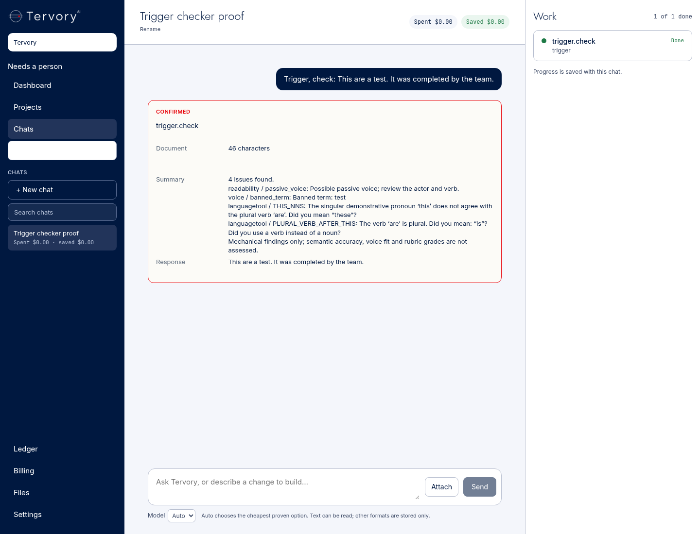
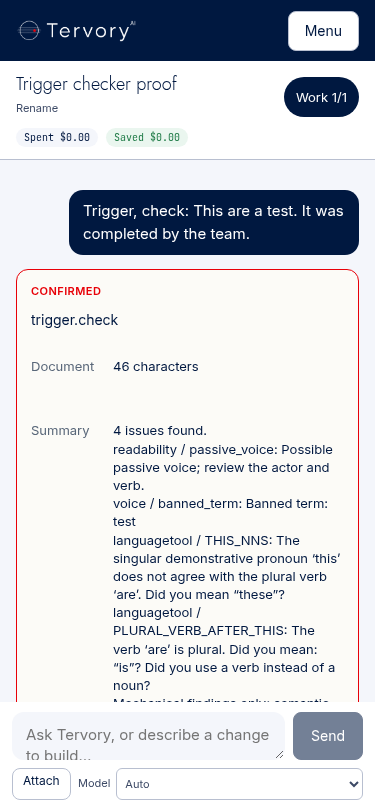

# Trigger first build: tenant voice, free checkers and existing chat actions

Branch: `codex/trigger-first-build`, started from main at `a99f3cb`. Implementation/proof checkpoint: `b9d9532` (subsequent handoff edits are documentation only). Claude opens the PR. No GitHub API, merge, deployment, main push, production SQL, owner-computer use or real model call was used.

**Build and offline proof are complete; live founder acceptance is pending.** The room is not deployed. CI cannot be claimed green: this repo starts branch CI on a PR, which Claude will open. The screenshots below are explicitly offline component proof, not the founder's live test.

## What changed (file and line)

| File | Result |
|---|---|
| `agents/trigger/app.py:19` | Authenticated internal room, database health, voice save, write and check endpoints. |
| `agents/trigger/voice.py:15`, `schema.sql:1` | Brand Voice Spec validation and one voice per tenant in `agent_trigger.voices`; tenant predicates and increasing revisions. No seed/example voice. |
| `agents/trigger/service.py:31` | Existing Zenas scope rules identify legal requests; legal writing returns a delegation before any Trigger model/checker execution. |
| `agents/trigger/service.py:53` | Draft once through the chassis Tank client at `/v1/route`, task `trigger.write`, with the complete tenant voice in the cache input; then run code checks on the returned text. |
| `agents/trigger/checkers.py:45` | Real proselint and unchanged upstream deterministic detectors; readability, banned/required words, selected stylebook candidates, Practical Prose checklist. |
| `agents/trigger/checkers.py:100` | Fixed internal LanguageTool destination; visible partial/unavailable status; no model fallback. Bound report size with explicit total/truncation. |
| `agents/trigger/Dockerfile:1`, `docker-compose.yml:1` | Own room and private checker container, resource limits, health checks, no public port/provider keys. Reuse Zenas scope source unchanged. |
| `tank/trigger_routes.py:19` | Actual code receipts through the existing ledger; Tank's existing pricing trigger owns comparison values. |
| `tank/trigger_routes.py:28` | Deterministic `Trigger, check: …` / `Trigger, check this paragraph: …` selection, retaining existing confirmation. |
| `tank/trigger_routes.py:70` | Authenticated same-box delegation through the existing Zenas drafting endpoint, retaining the result and notice. |
| `tank/trigger_routes.py:91` | Trusted Command identity, tool access and tenant checks; founder-only voice updates; bounded action bodies. |
| `tank/command.py:31`, `:818`, `:864` | Two Trigger tools and existing adapter plumbing. Founder tool catalogue includes Trigger; client entitlement whitelist is unchanged. Trigger POST scope goes in the body, not query parameters. |
| `tank/main.py:4093`, `tank/Dockerfile` | Route registration and module COPY only; no router/cache/worker changes. |
| `tank/schema.sql:1922` | Additive idempotent write/check policies, tenant write cache, 99% / 200 graduation bar, no automatic promotion. |
| root `docker-compose.yml`, `.env.example` | Own corridor, role provisioner variable and room key name. Only Tank/Postgres join Trigger's main-stack corridor. |
| `tests/trigger_first_build/test_trigger.py`, `browser.cjs` | Offline contracts, real isolated Postgres/LanguageTool integration and unchanged-window projection proof. |

No Workspace page, UI copy, other room implementation, approved skill version, or `tests/dashboards-ui.cjs` was edited.

## Approved sources, licences and pins

Full credit/licence notices: [ATTRIBUTION.md](../../agents/trigger/ATTRIBUTION.md). Vendored-byte checks: [checksums.json](../../agents/trigger/sources/checksums.json). Exact source/image pins: [pins.json](../../agents/trigger/sources/pins.json).

| Source | Pin | Commercial-use licence and use |
|---|---|---|
| [brand-voice-spec](https://huggingface.co/datasets/thehonestape/brand-voice-spec) | `e9d26dbecb2a0d5c023d4fb8d8f954e0ca4cdd54` | CC BY 4.0; format adapted into tenant validation/storage. Attribution retained. **No fictional coffee content is copied, seeded or displayed.** |
| [agent-style](https://github.com/yzhao062/agent-style) | `d1bdb0fa0c6305942bf43805edeae330946e8cf7` | Rules CC BY 4.0, scripts MIT. Vendored rules/detectors unchanged; deterministic subset only. |
| [agent-stylebooks](https://github.com/Neeeophytee/agent-stylebooks) | `85b318fcb69fbb50b9f066aadf81750d368c6988` | MIT original guidance; original 11 books only. Third-party source guides discussed by these books are not relicensed/copied. |
| [practical-prose](https://github.com/jlevy/practical-prose) | `fc0b2a725dd3d8b0dd347f92058b184a01eac44d` | MIT code / CC BY 4.0 content; rubric only. **Scorer absent and never called.** |
| [proselint](https://github.com/amperser/proselint) | v0.16.0, `a83a6164999803909f69eb3274d783c7070e73c1` | BSD-3-Clause; pinned Python dependency. |
| [LanguageTool](https://github.com/languagetool-org/languagetool) | 6.8; image below | LGPL; self-hosted Java server, no public/paid API. |
| [LanguageTool container packaging](https://github.com/meyayl/docker-languagetool) | 6.8-13, `be5d96f53563c7c5c07a4bd2e965b2e141810a76` | LGPL-2.1; packager applies dependency updates. |

Exact LanguageTool image: `meyay/languagetool:6.8-13@sha256:062924c66c649d706d60aed80af6bab207bb50a053733e7ac1ca0d8446d150f1`. The fixed Java entrypoint bypasses optional model downloads; checker network is internal. OpenCopy, Lubb Writer, DNA Studio and OpenGrow are excluded.

Original 11 stylebooks: 18f-content, apple-interface-writing, github-docs, gitlab-docs, google-developer-docs, govuk, kubernetes-docs, mailchimp-content, mdn-web-docs, microsoft-writing-style, red-hat-docs. A tenant selects one in its voice. All are available as writing guidance; only literal Avoid-section and link-text candidates are checked in code, with no semantic grade.

### Rules deliberately not scored

Agent-style runs `RULE-05`, `RULE-06`, `RULE-12`, `RULE-A`, `RULE-B`, `RULE-C`, `RULE-D`, `RULE-E`. Skipped rules are returned in every report:

- `RULE-01`, `RULE-03`, **`RULE-04`**, `RULE-08`, `RULE-11`, `RULE-F`, `RULE-H`: semantic/evidence/context evaluation is not performed. Hook-only LaTeX detectors for parts of 03/08 are not used for general copywriting.
- `RULE-02`, `RULE-07`, `RULE-09`, `RULE-10`: the upstream structural audit has no implemented detector. The separately labelled passive-voice code check finds candidates; it does not decide whether the actor matters.
- `RULE-G`, `RULE-I`: global technical-paper title case/full-form conventions can conflict with a tenant's voice/selected guide, so are not imposed on every industry and format.

Practical Prose: E1 clarity uses grammar/readability findings, E3 concision uses mechanical phrase findings, F3 formatting checks fence balance. These are a **checklist subset**, not scores for those dimensions. The other dimensions, truth/citation quality, semantic coherence and voice fit remain unassessed. No rubric grade, semantic quality claim or model-based checking is fabricated.

## Decisions I made

- Kept this first build founder-only. The current tenant_squad database constraint has no Trigger entry; no new grant authority or client-wide access was created.
- Reused the existing funded `luna` policy route for writing and the existing Tank ladder/cache. No new paid vendor, key or provider selection logic.
- Kept Zenas as the single legal drafting engine and its existing same-box/home/tenant/criminal gates. Legal requests require its existing template and jurisdiction. Explicit product descriptions, website copy and articles about a legal industry remain nonlegal writing; an explicit legal document/template always takes precedence. Its current response may lack a ledger ID; Command's existing pending receipt behavior applies rather than inventing one.
- Stored only tenant-provided live voices. `requiredTerms` is an explicit extension; preferred words are not automatically mandatory. Voice revision/content participate in the tenant cache key. Current voice is checked on every write, including cached drafts.
- Used a code intent path for explicit Trigger check prefixes, so those whole turns need no model selection. Other free-form conversation still uses the existing planner; every `trigger.check` action itself remains model-free.
- Used English/en-US LanguageTool for this first build. Passive voice and stylebook phrase hits are advisory candidates, with limitations disclosed.
- Capped text at 20,000 characters and returned findings at 200 with the full count and a visible truncation message. This preserves the existing Command response-size boundary. LanguageTool failure/partial results are visible and never trigger a paid fallback.
- Reserved **2 GiB** for LanguageTool (`-Xmx1536m`) and **512 MiB** for the room. Grok should confirm at least **3 GiB additional available box memory** beyond the existing stack. The small real check used ~316 MiB initially; this is not load-test capacity proof.
- Used local downloaded wheels to verify the room image after Docker build-time DNS blocked package downloads. The repository Dockerfile is unchanged for this transport accommodation. No claim that a normal network build succeeded here.

## Exact commands and results

All commands ran in the saved cloud workspace, `/workspace/tervory-tank`. Test fixtures are isolated and never sent to production. Existing dummy test credentials are test-only; no real secret was requested/read/generated.

```bash
/tmp/trigger-venv/bin/pip install -r tank/requirements.txt -r tank/requirements-dev.txt
/tmp/trigger-venv/bin/pip download -r agents/_chassis/requirements.txt -r agents/trigger/requirements.txt -d /tmp/trigger-wheels
/tmp/trigger-venv/bin/pytest -q tests/test_command.py tests/trigger_first_build/test_trigger.py tests/test_room_seal.py tests/test_secrets.py --tb=short
# 128 passed, 38 skipped (database not yet supplied), 7 warnings.
/tmp/trigger-venv/bin/pytest -q tests/trigger_first_build/test_trigger.py tests/test_zenas_draft.py --tb=short
# 24 passed at that checkpoint; includes existing Zenas criminal refusal/drafting contracts.
```

The initial Command run reported missing `redis`; installing the repository's exact test requirements above resolved that environment issue. No product workaround was added.

For the isolated image build, copied `_chassis`, `trigger`, Zenas `scope_rules.py`/`areas.json`, and downloaded wheels into `/tmp/trigger-build-context`. Only that temporary Dockerfile gained `COPY wheels /wheels` and `--no-index --find-links=/wheels` on its existing pip command. The source Dockerfile remains unchanged.

```bash
DOCKER_CONFIG=/tmp/trigger-docker-config docker build -t trigger-first-build:test -f /tmp/trigger-build-context/trigger/Dockerfile /tmp/trigger-build-context
# PASS; final image sha256:39020be733f07628723e74631900f6ee07e4b7e35c71ef73872d135511446b03
docker run --rm trigger-first-build:test python -c 'import trigger.app; print("Trigger image imports as non-root")'
# Trigger image imports as non-root
```

LanguageTool was started with the compose image, user 783, Java arguments, config, 2 GiB limit, read-only filesystem, tmpfs, dropped capabilities and no-new-privileges, on the isolated `trigger-test-checkers` network. A temporary test-only port was initially attempted but was not reachable from the shell; all successful checks used container-local/internal HTTP. The shipped compose has no published ports. The alias `trigger-languagetool` was added on the test network. Postgres used trust auth **only on that isolated test network**, no published port, no real credentials/data.

```bash
docker exec trigger-lt-test wget -Y off -qO- --post-data 'language=en-US&text=This%20are%20a%20test.' http://127.0.0.1:8081/v2/check
# PASS: LanguageTool 6.8, premium=false; THIS_NNS and PLURAL_VERB_AFTER_THIS.
docker stats --no-stream --format '{{.Name}} {{.MemUsage}}' trigger-lt-test
# Initially 316.2MiB / 2GiB after the grammar check; not a load test.
docker run -d --name trigger-pg-test --network trigger-test-checkers -e POSTGRES_HOST_AUTH_METHOD=trust postgres:16
```

Real Tank/Command/Trigger schema and boot verification (at integration checkpoint):

```bash
docker run --rm --name trigger-contract-test --network trigger-test-checkers \
  -v /workspace/tervory-tank:/workspace/tervory-tank \
  -v /tmp/trigger-venv/lib/python3.12/site-packages:/test-packages:ro \
  -w /workspace/tervory-tank \
  -e PYTHONPATH=/test-packages:/workspace/tervory-tank/tank \
  -e POOL_SCHEMA_DATABASE_URL=postgresql://postgres@trigger-pg-test:5432/postgres \
  -e PYTEST_ADDOPTS=--basetemp=/tmp/pytest-trigger --user 0 trigger-first-build:test \
  python -m pytest -q tests/trigger_first_build/test_trigger.py tests/test_command.py tests/test_tank_boots.py --tb=short
# 96 passed, no skips. Real Tank starts twice; schema reapplies; Command regressions pass.
```

Final focused room/contracts, with the real internal LanguageTool and real Postgres:

```bash
docker run --rm --network trigger-test-checkers \
  -v /workspace/tervory-tank:/workspace/tervory-tank \
  -v /tmp/trigger-venv/lib/python3.12/site-packages:/test-packages:ro \
  -w /workspace/tervory-tank \
  -e PYTHONPATH=/test-packages:/workspace/tervory-tank/tank \
  -e POOL_SCHEMA_DATABASE_URL=postgresql://postgres@trigger-pg-test:5432/postgres \
  -e TRIGGER_INTERNAL_CHECKER_TEST=1 --user 0 trigger-first-build:test \
  python -m pytest -q tests/trigger_first_build/test_trigger.py --tb=short
# 29 passed, no skips; two non-fatal Pydantic register-name warnings.
```

The real-room test authenticates, saves a tenant voice, checks real grammar and banned-word findings, verifies another tenant's isolation, and asserts Tank route was never called. Schema tests apply both schemas twice, prove 99%/200 policy settings and inspect real scoped zero-cost ledger rows. Other fixtures cover unchanged input, model-free check selection, one Tank draft call, required words, selected guides, long reports, legal handoff/notice, stale revisions and checker outage/incomplete results. The final check selector also passed its targeted test after changing JSON encoding to preserve Unicode.

```bash
/tmp/trigger-venv/bin/pytest -q tests/trigger_first_build/test_trigger.py -k 'code_plan' --tb=short
# 1 passed, 23 deselected.
/tmp/trigger-venv/bin/ruff check tank tests --select E9,F --per-file-ignores 'tank/skills/base.socials/1.0.0/run.py:F401'
/tmp/trigger-venv/bin/ruff check agents/trigger/{app,voice,service,checkers}.py --select E9,F
git diff --check
# All passed.
node tests/trigger_first_build/browser.cjs
# PASS: real CommandWindow shows unchanged text and actual internal checker report
# after confirmation and reload; 1440px and 375px, no overflow/runtime errors.
```

Browser dependencies: `npm_config_cache=/tmp/trigger-npm-cache npm install --prefix /tmp/trigger-browser-tools --no-audit --no-fund esbuild@0.28.2 playwright@1.64.1`; existing `/usr/bin/chromium`. [check-report.json](check-report.json) is the captured real internal checker output for test text. The browser harness supplies that output through a fixture HTTP adapter; it does not claim a live end-to-end draft or an authenticated founder session.

## Remaining deployment/acceptance handoff

Grok: create `agent-trigger`, confirm the memory headroom above, provision `AGENT_DB_PASSWORD_TRIGGER` / `TANK_KEY_TRIGGER` by name, deploy main corridor/role before the room, enable Raw Compose, and verify isolation. See [room runbook](../../agents/trigger/README.md). Founder supplies their own voice, never the dataset's example. No secret values belong in this PR.

After Claude opens the PR, wait for its actual CI result. After founder merge and authorized deployment, the founder must run both acceptance checks in `/chats`: request a short product description with their voice and see draft plus checker report; then use `Trigger, check: <their paragraph>`, confirm and see findings with no model call. Capture those **live founder screenshots**. They are not available in this cloud build, so the product's DONE condition is not claimed.

What changed: new Trigger room, scoped voice, free checker pipeline, existing Tank/Command/Zenas integration and additive policy seeds. Tests: 29 focused real-room contracts, 96 integration/boot checks at the integration checkpoint, existing Zenas/room-seal/secret regressions and lint as recorded above. Screenshots of the unchanged window, **offline proof only**:



