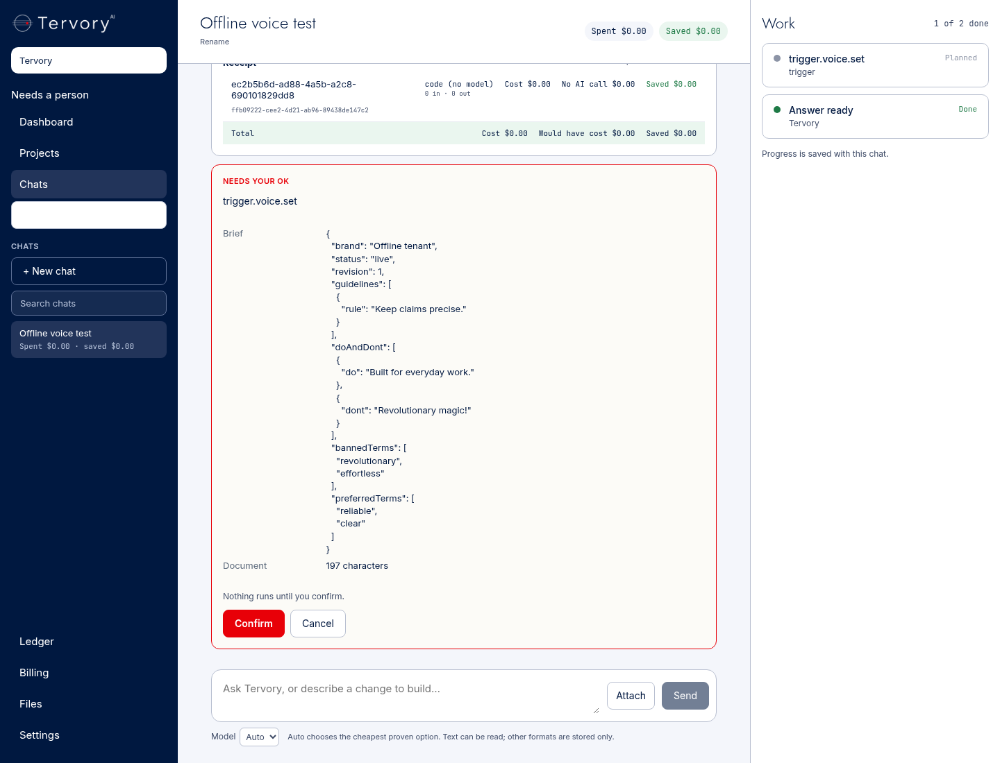
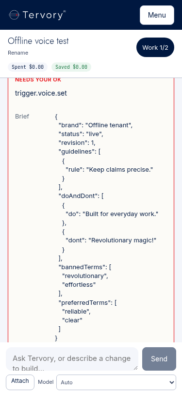
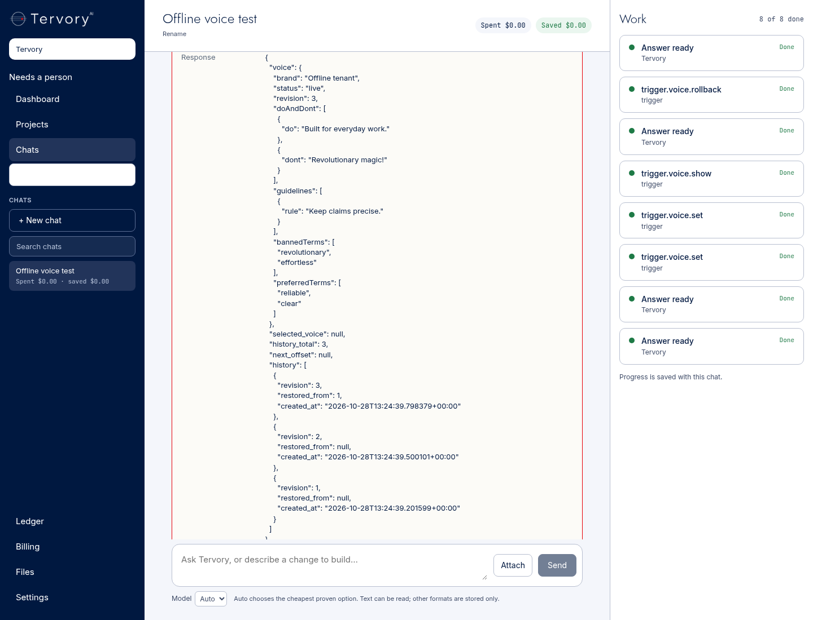
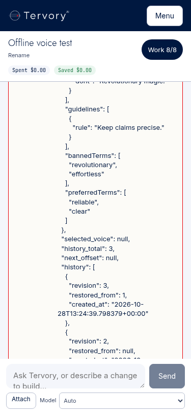

# Trigger second build: voice history, fallback house style and private learning records

Branch: `codex/trigger-second-build`, from main `1c78aaa`, including merged #385 (`b8704cc`). Code/proof checkpoint: `1933b57`; the final handoff commit changes this document only. Claude opens the PR, as in the first build. No GitHub API, main push, merge, deployment, production SQL, real model call or owner's computer was used.

The build and offline checks are complete. **Live founder acceptance and PR CI remain pending.** The images below are explicitly offline browser proof using real test API snapshots, not a live founder session.

## What changed

| File and line | Result |
|---|---|
| `agents/trigger/voice_parser.py:20` | Code-only plain-text parser: authored rules, preferred/banned/required words, tone and on/off-voice examples. No inferred brand, paired example, or new rule. |
| `agents/trigger/voice_history.py:13` | Read-only previews, immutable versions, tenant-scoped history, optimistic revision check, serialized concurrent saves, idempotent confirmed operation IDs and rollback as a new revision. |
| `agents/trigger/schema.sql:9` | Additive/idempotent version table; seeds the existing current voice into history without modifying it. |
| `agents/trigger/app.py:66` | Internal authenticated preview/show/commit routes. The old direct PUT route is removed; writes no longer accept inline raw voice JSON. |
| `agents/trigger/house_style.py:3`, `checkers.py:90`, `service.py:53` | One industry-neutral fallback, applied in the prompt and code checks only when there is no saved tenant voice. No fallback voice file is seeded. |
| `tank/trigger_commands.py:14` | Deterministic voice and latest-draft feedback commands; no planner model call for these prefixes. |
| `tank/trigger_commands.py:52`, `tank/command.py:1057` | Compare voice text with the actual user message, parse on the server, and place the exact spec in the existing Confirm card's Brief field. |
| `tank/trigger_commands.py:73`, `tank/trigger_routes.py:95` | Bind mutation dispatch to the committed executing card, tenant, user, tool and exact validated arguments. Direct unconfirmed mutations fail. |
| `tank/trigger_learning.py:12` | Save each successful `trigger.write` tool result using the existing `training.save_pair`: brief, draft and checker report, private to the tenant. |
| `tank/trigger_learning.py:30`, `tank/schema.sql:1949` | Preserve accepted/change-requested/rejected events, exact change text, user and operation ID. Pending/rejected/change-requested pairs are inactive; accepted pairs remain tenant-private. |
| `workspace/lib/trigger.ts:1`, `workspace/lib/tank.ts:911` | Reuse existing Clerk session roles, binding user, organization and mapped tenant. Override caller role headers; never trust browser-supplied roles or squads. |
| `workspace/app/chats/page.tsx`, `workspace/app/chats/api/[...path]/route.ts` | Pass verified existing tenant-admin authority into the existing chat path. No new UI, text, buttons or sign-in flow. |
| `tests/trigger_second_build/` | Parser, confirmation, isolation, concurrency, learning, Clerk boundary and browser proof. Existing Command tests are retained; their mocks include the new server role helper. First-build fixtures now use the confirmed voice workflow/house fallback. |

Tank's current Dockerfile already copies `*.py`, so it includes both new Tank modules without another Dockerfile change. No router, cache, queue worker, paid route, approved skill version, vendor dependency or other-room implementation was changed.

## How the existing chat works

- `trigger.voice.set:` followed by the user's plain text. Optional headings are `Brand:`, `Rules:`, `Preferred words:`, `Banned words:`, `Required words:`, `Tone:`, `On-voice:` and `Off-voice:`. Unlabelled lines remain literal rules; word lists support CSV quoting. The existing card's Brief shows the spec before **Confirm**. Cancel does not save a voice.
- `trigger.voice.show` shows the current file and version history. `trigger.voice.show: version 2` reads that saved version without activating it. `trigger.voice.show: 20` reads the next history page (20 entries per page).
- `trigger.voice.rollback: 2` previews that content and restores it only after Confirm, as a new revision. Old/intervening versions remain.
- `trigger, accept`, `trigger, reject: <reason>` and `trigger, changes: <requested changes>` select this owned thread's latest completed Trigger draft in code. Confirm records feedback. `trigger.feedback` also accepts an explicit write ID in its argument schema.
- `Trigger, check: <paragraph>` retains the first build's fully model-free check path. Other conversational phrasing may still use the existing planner; none of the voice/check/feedback operations use a model.

Founders and the active tenant's Clerk `org:admin` may manage that tenant's voice and feedback. Ordinary members cannot acquire those tools through headers, payloads, a stale Confirm card, or another tenant ID. Write/check retain the first build's founder access; no new client squad grant was created.

## House rule sources and licences

All 11 original vendored stylebooks contribute. The pinned source remains `Neeeophytee/agent-stylebooks` at `85b318fcb69fbb50b9f066aadf81750d368c6988`, **MIT original guidance**. Upstream external publishers' original guides are not copied/relicensed. Their attribution/provenance and the MIT notice remain in the repo. Exact sections/line references are in [HOUSE_STYLE.md](../../agents/trigger/HOUSE_STYLE.md).

| House rule | Contributing books | Code implementation |
|---|---|---|
| Common words / difficulty judgments | GOV.UK, 18F, Microsoft, Google, GitLab, Kubernetes | Literal word candidates; existing proselint/agent-style checks remain. |
| Prefer active voice | Mailchimp, GitHub, MDN, Red Hat | Reuse the first build's passive-voice candidate detector. |
| Descriptive link text | GOV.UK, Google, Apple, GitHub | Literal Markdown link labels `click here`, `here`, `read more`. |
| Focused/short sentences | GOV.UK, Microsoft, MDN | Reuse the existing agent-style 30-word threshold. The number comes from the checker, not an invented quote from a stylebook. |

The checker scripts reused from agent-style are MIT; its rules are CC BY 4.0; proselint is BSD. Brand Voice Spec remains CC BY 4.0 with repo attribution, **format only**. No coffee-brand content is imported or displayed. No semantic scoring, paid checker, Practical Prose scorer, model-based parsing or model-based checking was added. House findings are mechanical review candidates, not judgments about truth or brand fit. A saved tenant voice disables the additional house rules, while the general first-build grammar checks continue.

## Decisions I made

- Reused the existing card's Brief/Confirm/Cancel and tool-result fields. The spec/history are result data; no page component or wording was added.
- Used explicit plain-text section headings for deterministic parsing. Unknown/unlabelled content is preserved as authored rules rather than interpreted by a model. An absent brand stays empty; examples are not artificially paired. Generated status/revision are storage metadata. Default checker settings are not serialized as user-authored rules.
- A set operation replaces the current file in a new version; it does not silently merge old rules. Preview/save uses the same parser and content hash, with the expected previous revision. Two concurrent confirmations cannot overwrite each other.
- History begins with the existing current file on schema application. Versions overwritten before the second build cannot be reconstructed. Rollback increments revision while restoring the selected content, so cache identity changes correctly.
- Retired inline `trigger.write.voice` and the old room PUT route to avoid a second, unversioned save path. Existing saved files/results remain. Pending old inline-voice cards fail closed and need the new set flow.
- Reused Clerk's existing `org:admin` role; no sign-in behavior, new key, browser authority, or broad squad entitlement. The role is re-read by Workspace on each request, including Confirm.
- New learning pairs are inactive and unapproved until explicit accepted feedback. Rejections and requested changes are retained as inactive negative records, with all feedback events in the tenant-scoped event table. Even accepted pairs have `public=false` and `client_matter=true`, so the existing shared export path excludes them. No automatic training/promotion was added.
- Recording feedback does not generate a revision draft. The next requested write is a separate recorded draft; no acceptance is inferred from silence. Pending is an honest state.
- Use the previous PR's handoff convention: proof in this file, Claude opens the PR. No GitHub API was used to inspect/open one.

## Exact checks and evidence

Everything ran in the saved cloud coding environment at `/workspace/tervory-tank`. Test Postgres and LanguageTool used an isolated internal Docker network, no production data and no published ports. Existing dummy test credentials are fixtures only. No real secret was read/requested/generated.

```bash
git fetch origin main
git switch -c codex/trigger-second-build origin/main
# base 1c78aaa, including #385 b8704cc
/tmp/trigger-venv/bin/pip install -r tank/requirements.txt -r tank/requirements-dev.txt
# Installed current main's exact test dependencies (including its new jiter dependency).
docker network create --internal trigger2-test
docker run -d --name trigger2-pg --network trigger2-test -e POSTGRES_HOST_AUTH_METHOD=trust postgres:16
```

The existing first-build Python image was used **only as a test runtime**. Current branch sources and current pinned host-installed test packages were mounted into it. This is not a claim of building/deploying a new production image.

```bash
docker run --rm --network trigger2-test \
  -v /workspace/tervory-tank:/workspace/tervory-tank \
  -v /tmp/trigger-venv/lib/python3.12/site-packages:/test-packages:ro \
  -w /workspace/tervory-tank \
  -e PYTHONPATH=/test-packages:/workspace/tervory-tank/tank \
  -e POOL_SCHEMA_DATABASE_URL=postgresql://postgres@trigger2-pg:5432/postgres \
  --user 0 trigger-first-build:test python -m pytest -q \
  tests/trigger_second_build/test_second.py tests/trigger_first_build/test_trigger.py \
  tests/test_command.py tests/test_tank_boots.py --tb=short
# 112 passed, 1 skipped. The skip was the optional real LanguageTool-container check, run below.
```

Final focused tests added the concurrent-confirm/history-read case and source/quote-boundary case:

```bash
docker run --rm --network trigger2-test \
  -v /workspace/tervory-tank:/workspace/tervory-tank \
  -v /tmp/trigger-venv/lib/python3.12/site-packages:/test-packages:ro \
  -w /workspace/tervory-tank \
  -e PYTHONPATH=/test-packages:/workspace/tervory-tank/tank \
  -e POOL_SCHEMA_DATABASE_URL=postgresql://postgres@trigger2-pg:5432/postgres \
  -e TRIGGER_SECOND_EVIDENCE=/workspace/tervory-tank/tests/trigger_second_build/window-fixtures.json \
  --user 0 trigger-first-build:test python -m pytest -q tests/trigger_second_build/test_second.py --tb=short
# 10 passed; real Postgres, real Command confirmation and room HTTP validation; planner/model fail-on-call for voice operations.
```

The tests apply both schemas twice; preserve literal source; demonstrate zero saved voice/history rows before Confirm or after Cancel; replay Confirm without creating a version; reject stale/concurrent previews; restore a version; deny foreign-tenant reads and unconfirmed saves; enforce admin revocation at confirmation; inspect actual private training-pair/feedback rows; and show fallback house checks only without a voice.

```bash
/tmp/trigger-venv/bin/pytest -q tests/trigger_second_build/test_second.py -k 'house_style_only or bad_quotes' --tb=short
# 2 passed after the final provenance mapping correction.
/tmp/trigger-venv/bin/pytest -q tests/test_secrets.py tests/test_room_seal.py --tb=short
# 74 passed.
node tests/trigger_second_build/admin_contract.cjs
# PASS: existing Clerk user/org/tenant binding; forged role/squad/tenant headers cannot grant voice access.
node tests/command_1b_contract.cjs
node tests/command_1b_pages.cjs
# Both PASS, retaining existing stream, CSRF, files, evidence, Auto-only and page-boundary assertions.
```

Workspace verification, from `workspace/`:

```bash
mv .next/types /tmp/trigger2-next-types-stale
node node_modules/next/dist/bin/next typegen
node node_modules/typescript/bin/tsc --noEmit
NEXT_TELEMETRY_DISABLED=1 \
NEXT_PUBLIC_CLERK_PUBLISHABLE_KEY=pk_test_ZHVtbXkuY2xlcmsuYWNjb3VudHMuZGV2JA== \
CLERK_SECRET_KEY=sk_test_dummy node node_modules/next/dist/bin/next build
# All PASS. These are the repository CI's dummy Clerk values, not credentials.
```

The first type-check encountered stale generated `.next/types` for a route removed on main. Moving the generated directory aside and regenerating it fixed that; no product-code workaround was added. No successful unchanged suite was restarted just to obtain status.

Real LanguageTool check (same image/config/limits as the first build, internal network alias `trigger-languagetool`):

```bash
docker exec trigger2-lt wget -Y off -q -O /dev/null http://127.0.0.1:8081/v2/languages
docker run --rm --network trigger2-test \
  -v /workspace/tervory-tank:/workspace/tervory-tank \
  -v /tmp/trigger-venv/lib/python3.12/site-packages:/test-packages:ro \
  -w /workspace/tervory-tank \
  -e PYTHONPATH=/test-packages:/workspace/tervory-tank/tank \
  -e POOL_SCHEMA_DATABASE_URL=postgresql://postgres@trigger2-pg:5432/postgres \
  -e TRIGGER_INTERNAL_CHECKER_TEST=1 --user 0 trigger-first-build:test \
  python -m pytest -q tests/trigger_first_build/test_trigger.py -k real_room_with_internal_languagetool --tb=short
# 1 passed, 28 deselected. Real authenticated room, real LanguageTool, no model call.
/tmp/trigger-venv/bin/ruff check tank tests agents/trigger/{app,voice,voice_history,voice_parser,house_style,service,checkers}.py \
  --select E9,F --per-file-ignores 'tank/skills/base.socials/1.0.0/run.py:F401'
git diff --check
# PASS.
node tests/trigger_second_build/browser.cjs
# PASS: actual CommandWindow, production snapshot normalization/projection, preview before Confirm,
# saved history after reload; 375px and 1440px; no horizontal overflow or runtime errors.
```

The Pydantic `register` name warning and existing FastAPI lifespan warnings are non-fatal. [window-fixtures.json](window-fixtures.json) is captured from the isolated real API test; the browser supplies those responses through a local fixture server. It does not call a live tenant or model.

## Remaining acceptance

Claude opens the PR; wait for its actual CI result. Existing Tank and Trigger deployments must receive the additive schemas/code after founder review/merge. No new resource, secret name, paid service or page is required. Risky tenant/learning changes remain for Claude's review under the rules block.

In the founder's browser: paste their real notes, inspect the existing Confirm card, cancel once and show that nothing was saved, then confirm; read history and roll back; write in that voice, request changes, accept/reject, and inspect that tenant's learning record. Repeat voice management as an admin of their own tenant and verify another tenant stays inaccessible. Test writing in a tenant with no file for house style. **Those live screenshots/acceptance are not available in this cloud build and are not claimed.**

What changed: versioned voice tools with confirmed code parsing, an attributed code-only house fallback, private writing/feedback training pairs. Tests: 10 focused contracts, 112 broader regression/boot checks, 74 room/secret checks, real LanguageTool, Workspace contracts/type-check/build, and browser proof as recorded above. Screenshots below are **offline proof only**:





